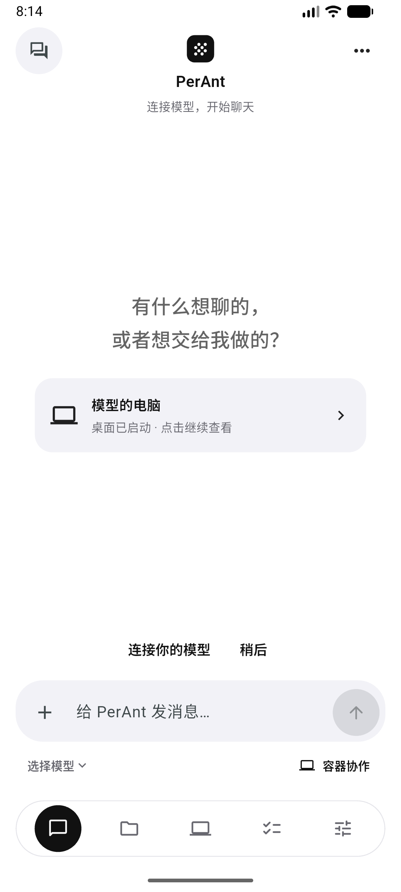
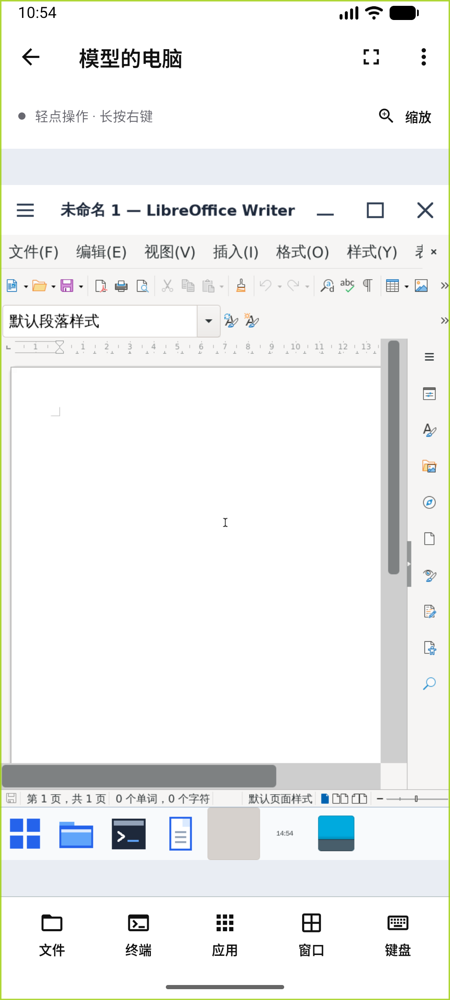
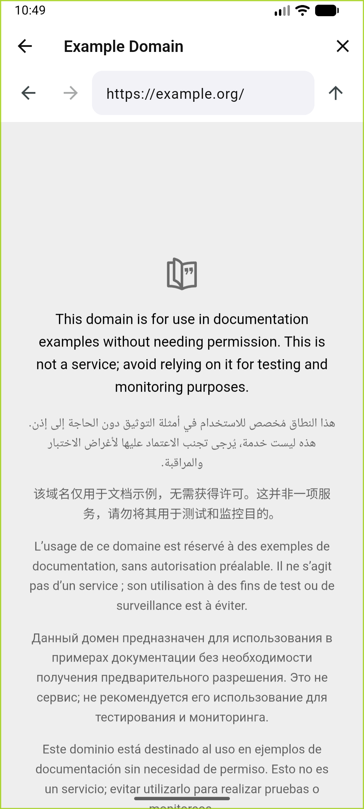

# PerAnt

PerAnt 是一个以对话为入口的手机个人智能体工作台。目标是让用户与模型在同一台本地“电脑”中协作：查看资料、运行 Linux 工具、编辑文件，再把结果带回对话。

当前为 **0.8.0+2008 源码预览版**，主要实现和验证集中在 **Android ARM64**。Flutter 共享界面与业务逻辑，原生组件连接 Linux、桌面和浏览器；复杂任务可使用用户自行配置的 OpenAI 格式兼容 API。**本地小模型、iOS 运行时、长期后台、检索与记忆尚未接入，当前不是完整的双端个人智能体产品。**

## 界面预览

以下为 Android APK 的真实截图：对话页来自 0.6，电脑与浏览器来自 0.7。点击可查看原图，版本和来源见[截图说明](docs/images/README.md)。

<table>
  <tr>
    <th>对话优先</th>
    <th>本地 Linux 电脑</th>
    <th>原生浏览器</th>
  </tr>
  <tr>
    <td><a href="docs/images/chat-android-v06.png"></a></td>
    <td><a href="docs/images/linux-writer-android-v07.png"></a></td>
    <td><a href="docs/images/browser-android-v07.png"></a></td>
  </tr>
</table>

## 现在可以做什么

- **从对话开始协作。** 多会话、任务进度、操作记录与用户接管；界面参考 nanoMuse 的对话优先思路。API 配置可以跳过，也可自定义兼容服务地址、模型和参数，支持 Chat Completions / Responses。
- **使用手机内的 Linux 工作区。** Android 内接入 PRoot、Alpine、Python、真实终端和共享 `/workspace`，返回实际输出、退出码、取消及超时结果。
- **查看同一套桌面与文件。** Xfce、文件管理器、终端、文本编辑器和 LibreOffice Writer / Calc / Impress 按需启动，用户与模型共享窗口。离开查看页会释放持续取帧和 Flutter 图像，Linux 应用仍可保留。
- **浏览网页并保存文字资料。** Android 原生 WebView 提供地址栏、历史导航和交互；“保存网页文字”及模型工具 `browser_save_page` 可新建带来源、时间和截断说明的 Markdown，不覆盖原文件，也不停止已就绪桌面。正文文件总预算为 256 KiB，不包含附件、表单或内嵌页面。
- **管理本地成果。** 文件浏览、UTF-8 编辑、SHA256 冲突检测、Markdown 预览、文档版本确认和 SQLite 持久化。固定 Python 文字整理会保留原文并规范排版，尚不生成语义摘要。

模型工具只在本次容器协作授权下执行，普通聊天不自动获得文件、截图或键鼠权限。截图不写入 SQLite；API Key 使用平台凭据存储。结构化 Shell 命令逐条确认，GUI 终端输入属于明确授予的桌面控制范围。

使用方式与边界见[容器电脑](docs/CONTAINER_COMPUTER.md)、[基础应用](docs/DESKTOP_APPLICATIONS.md)和[网页文字保存](docs/BROWSER_PAGE_SAVE.md)。

## 预览版状态与限制

0.8 的本地验证记录如下，各类检查分别计数，不累加历史版本结果：

| 检查 | 当前记录 |
| --- | --- |
| 宿主检查 | Dart 252、Python 14、格式与静态分析通过；另 2 项可选截图跳过 |
| Android JVM | 72/72 通过，属于原生契约与组件检查 |
| Android 原生集成 | API 36 ARM64 模拟器 19/19：网页保存 4、浏览器 5、容器 7、原生存储/文档 3 |
| 独立原生发布核心 | 实际 Android ARM64 probe 6/6，与应用集成分别计数 |
| 本机构建的 0.8 APK | 静态核验、签名及安装摘要一致性通过 |
| 最终 APK 人工流程 | **未完成**“打开网页 → 保存文字 → 在 Linux 中打开”全流程；未取得手动保存回执或桌面打开证据 |

人工尝试中，应用可进入聊天和原生空白浏览器，但目标网址未按预期输入或提交；出现输入丢字、重音字符、粘贴无预期内容及一次界面控制超时，根因尚未确认。自动化通过不能替代这项未完成的人工验收。详情及历史结果见[开发状态](docs/DEVELOPMENT_STATUS.md)。

还需注意以下边界：

- 尚未使用真实模型服务完成端到端工具协作；协议测试使用模拟 API，不能代表所有兼容供应商均可用。
- 4 GB 实体手机、约 5 秒基础响应、系统中文输入法、长期后台和锁屏续跑均未通过验收。隐藏查看器不会让 Linux 窗口或 WebView 的内存归零，也不保证页面脚本与网络停止。
- Writer 的 ODT / DOCX 曾有 GUI 保存及重开测试；本轮没有重跑旧 Office、Linux 和桌面套件。Calc / Impress、复杂排版和完整多步共控仍需单独验证。
- 浏览器不提供附件下载、文件上传、PDF 查看或模型任意 JavaScript 执行。网页内容不能授予新权限；登录、提交、发送、付款等外部动作需要具体授权。
- PRoot 是 Linux 用户空间运行方案，不是已证明强隔离的虚拟机；当前也不支持操作其他 Android 应用。

## 接下来开发什么

按验收结果推进，不承诺固定完成日期：

1. **完成 Android 网页到 Linux 的人工闭环。** 定位输入不稳定，验证实际网址输入、保存回执、文件路径和在桌面编辑的全过程，补齐中文输入与异常恢复。
2. **跑通真实模型协作。** 使用实际兼容 API 验证工具往返、截图、取消和用户接管，完成“模型生成文件 → 用户修改 → 模型重新观察继续”的共享工作流。
3. **接入并测量本地小模型。** 引入原生 llama.cpp，对比小参数模型、量化和上下文配置，在 4 GB 实体手机上测量中文指令、基础工具能力、冷热启动、总内存和能耗；约 5 秒响应是验证目标。
4. **完善后台与恢复。** 验证 Android 前台服务、锁屏、断网和进程回收后的步骤恢复，保留已生成文件，避免重复执行副作用。
5. **建立资料检索与记忆。** 接入关键词和语义混合检索、来源追溯、可查看修改删除的长期记忆、备份迁移，以约 1,000 份文档验证规模。
6. **完善可交付的内容工作流。** 先完成文档与会议纪要的导入、整理、版本确认及 DOCX / PDF 导出，再加入课件和网页生成、预览与导出。
7. **验证 iOS 可行性。** 对 iSH、原生本地推理、文件交换、取消、生命周期与签名分发完成独立验证，再决定双端可用范围；Flutter 共享代码不等于 iPhone 运行时已就绪。

完整关卡、任务范围与未完成项见[任务规划书](TASK_PLAN.md)。本轮网页保存的增量通过，不代表 M0 双端可行性或完整 M1-D 共控关卡完成。

## 从源码构建 Android APK

**首次公开仅提供源码，不附带预编译 APK。**模型权重和生成的 Linux 二进制资源也不包含在源码仓库中。APK 可在本机构建；先完成 Linux 组件的对应源码归档与分发材料核对，再安排公开安装包发行。

当前工具链基线为 **Flutter 3.50.0 / Dart 3.14.0**、Android SDK API 36、NDK `28.2.13676358`、JDK 17 及以上（本地验证使用 JDK 21）、Python 3、GNU make，以及用于构建 PNG/XPM 兼容库的 Docker。先按 [Flutter 官方说明](https://docs.flutter.dev/install)准备 SDK；完整资源准备要求见[Linux 资源与来源](docs/LINUX_RUNTIME_SOURCES.md)。首次构建需要下载固定版本输入并预留足够磁盘空间。

从项目根目录执行：

```sh
tool/flutterw pub get
tool/prepare-linux-runtime
tool/check
tool/build-apk
```

脚本生成 Android 10 / API 29 及以上、仅 ARM64 的调试包与校验文件：

```text
artifacts/apk/PerAnt-0.8.0-debug-arm64.apk
artifacts/apk/PerAnt-0.8.0-debug-arm64.apk.sha256
```

用已授权 USB 调试的 Android 设备安装：

```sh
adb devices
adb install -r artifacts/apk/PerAnt-0.8.0-debug-arm64.apk
```

开发调试先执行 `tool/flutterw devices`，再在 `apps/perant` 中运行 `../../tool/flutterw run -d <设备ID>`。移动端以原生 APK 和设备/模拟器验证，不以网页预览替代。

包装器优先使用 `PERANT_FLUTTER_SDK`，其次项目 `.tooling/flutter`，最后 PATH 中的 Flutter；也会识别项目本地 Android SDK / JDK。SDK、缓存、APK 与生成资源不应提交为源码。

本仓库不配置 GitHub CI 测试，检查和 Android 构建在本地按上述命令执行。文档中的历史设备检查是本地验证记录；原始日志和本机构建包不随源码提交。

## 代码与文档

| 路径 | 职责 |
| --- | --- |
| `apps/perant` | Flutter 界面、任务编排、共享桌面与浏览器服务、持久化 |
| `packages/perant_core` | 任务、授权、文档、供应商和运行时契约 |
| `packages/perant_gateway` | OpenAI 格式 HTTP / SSE 传输，不执行工具 |
| `packages/perant_platform` | Android / iOS 原生边界、Linux / JNI PTY、RFB 与 WebView |
| `tool` | 检查、固定资源准备和 APK 构建脚本 |
| `third_party/linux` | 固定来源、许可与重建记录 |

进一步阅读：[任务规划书](TASK_PLAN.md) · [架构说明](docs/ARCHITECTURE.md) · [开发状态](docs/DEVELOPMENT_STATUS.md)。项目以个人配合 AI 的方式持续开发，当前优先把 Android 上的真实协作链路做可靠。

## 许可

自研代码使用 **GPL-3.0-only**，见 [LICENSE](LICENSE)。第三方组件保留各自许可、版权与声明，见 [Linux 第三方 NOTICE](third_party/linux/NOTICE.md)和[资源来源说明](docs/LINUX_RUNTIME_SOURCES.md)。

**GPL 允许合规商用、修改和再分发**，不能保证阻止他人合规分支或销售，也不自动授予 PerAnt 品牌使用权。发布二进制时，仍需按各组件许可提供对应版本的完整源码、修改、构建脚本及必要声明；固定下载地址和来源锁本身不等于完成对应源码分发义务。当前对应源码归档尚未完整，因此本次仅公开项目源码，不分发预编译 APK 或生成的 Linux 二进制资源。
