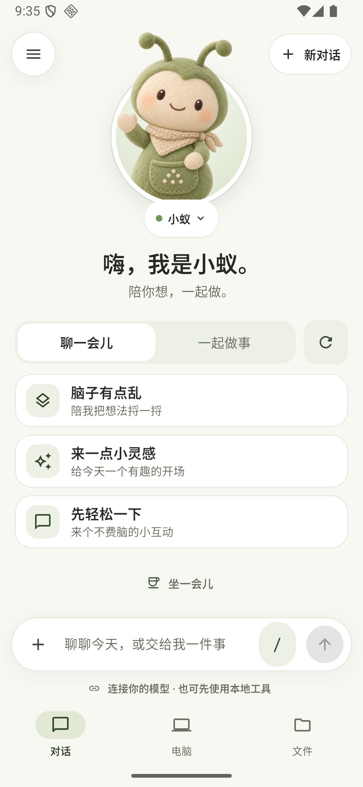
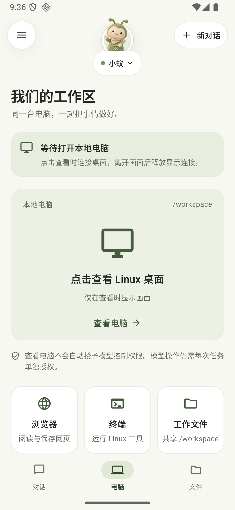

# PerAnt


PerAnt 是一个以对话为入口的手机个人智能体工作台。目标是让用户与模型在同一台本地“电脑”中协作：查看资料、运行 Linux 工具、编辑文件，再把结果带回对话。

当前源码版本为 **0.0.7+2016**。「模型设置 → 本地中文模型」可下载或导入 Qwen3.5，在设备上离线提问、查资料和建笔记。纪要可以分段归纳，编辑器可润色选中文字并核对差异。可在「文件 → 资料备份与诊断 → 离线语义检索」下载或导入约 24.1 MB 的中文模型。在「引用本机资料提问」中预览并勾选最多五段原文或记忆，可将所选材料发给已配置的模型。在「文件」中搜索中文关键词，可以打开对应修订并选中命中的原文。「资料备份与诊断 → 长期记忆」可查看、修改和删除本机提取的偏好。已确认的资料可以生成可编辑的课件大纲，核定后导出可在 PowerPoint 中继续编辑的 PPTX。也可生成静态 HTML，在 Android 工作区修改源码和离线预览。在「文件」中可导入 TXT、Markdown、DOCX 和文字 PDF，从最多五份资料整理带来源的会议草稿。打开文档可查看历史差异，确认版本后可离线导出 Word 和 PDF。Android 用户可以直接保存网页到工作区、打开摘录并修改文字。终端和图形桌面仍需初始化 Linux。版本号自 2026-11-16 起从 0.0.1 重新计算，此前的 0.6～0.9 是旧编号下的开发预览，记录保留为历史。0.0.1 第一次用真实模型服务（DeepSeek）实测并修复了对话、电脑协作和浏览器中的多处不可用问题，见 [0.0.1 说明](docs/releases/0.0.1.md)。主要实现和验证集中在 **Android ARM64**。Flutter 共享界面与业务逻辑，原生组件连接 Linux、桌面和浏览器；复杂任务可使用用户自行配置的 OpenAI 格式兼容 API。**iOS Linux 运行时、长期后台和双端真机验收仍在开发计划中。**

[项目首页](https://w1nnnd.github.io/PerAnt/) · [发布记录](https://github.com/W1nnnd/PerAnt/releases) · [0.0.1 说明](docs/releases/0.0.1.md) · [旧编号 0.9 说明](docs/releases/0.9.0-preview.md) · [开发计划](#接下来开发什么)

## 下载与安装

**[下载 Android APK · 0.0.1](https://github.com/W1nnnd/PerAnt/releases/download/v0.0.1/PerAnt-0.0.1-debug-arm64.apk)** · [SHA256 校验清单](https://github.com/W1nnnd/PerAnt/releases/download/v0.0.1/SHA256SUMS) · [同版本对应源码与发布说明](https://github.com/W1nnnd/PerAnt/releases/tag/v0.0.1)

旧编号的 [0.9.0 预览包](https://github.com/W1nnnd/PerAnt/releases/tag/v0.9.0-preview)仍可下载，但它发布前没有连接过真实模型服务，自己输入的任务不会真正执行，不建议使用。0.0.1 可以直接覆盖安装 0.9.0。

将 APK 下载到手机后打开，按 Android 提示允许安装。已有 0.9.0 或本机开发版可覆盖安装；如系统提示签名不一致，先保留重要文件，勿直接卸载清除数据。GitHub Release 同时提供三卷 Linux 对应源码与匹配的 PerAnt 源码，普通安装只需 APK；源码重组和校验见[发行材料说明](docs/PUBLIC_BINARY_RELEASE.md)。本机构建见[构建说明](#从源码构建-android-apk)。

安装包要求 **Android 10 / API 29 及以上、64 位 ARM（arm64-v8a）**。当前是包含 Linux 和办公组件的调试包，体积约 **518 MiB**；不支持 32 位 ARM 或 x86，尚无 iPhone 安装包。首次启动还需解包 Linux 资源，请预留额外存储空间；解包后的完整空间预算尚待实测。

APK SHA256：`aa5e7a9f79c4f00abe5ba78d7a319b60e1a364657c8c566ab47a56ee310e916b`。

## 界面预览

旧编号 0.9 将暖白与鼠尾草绿、圆框小蚁头像和「对话 / 电脑 / 文件」三项导航接入正式 Flutter 应用。昵称、界面语气和震动偏好保存在本机；授权、任务和文件操作继续连接真实控制器。迁移范围见 [Concept 06 实现说明](docs/UI_CONCEPT06_IMPLEMENTATION.md)，图标源图与提示词见 [图标说明](apps/perant/assets/branding/README.md)。

以下为 **旧编号 0.9.0 Android APK** 在模拟器中的真实截图，使用原始图片，未重绘界面；0.0.1 只在输入框旁多了一个电脑按钮。点击可查看原图，版本与来源见[截图说明](docs/images/README.md)。

<table>
  <tr>
    <th>对话优先</th>
    <th>我们的工作区</th>
    <th>我的文件</th>
  </tr>
  <tr>
    <td><a href="docs/images/home-android-v09.png"></a></td>
    <td><a href="docs/images/computer-android-v09.png"></a></td>
    <td><a href="docs/images/files-android-v09.png"></a></td>
  </tr>
</table>

## 现在可以做什么

- **从对话开始协作。** 多会话、任务进度、操作记录与用户接管；界面参考 nanoMuse 的对话优先思路。API 配置可以跳过，也可自定义兼容服务地址、模型和参数，支持 Chat Completions / Responses。
- **使用手机内的 Linux 工作区。** Android 内接入 PRoot、Alpine、Python、真实终端和共享 `/workspace`，返回实际输出、退出码、取消及超时结果。
- **查看同一套桌面与文件。** Xfce、文件管理器、终端、文本编辑器和 LibreOffice Writer / Calc / Impress 按需启动，用户与模型共享窗口。离开查看页会释放持续取帧和 Flutter 图像，Linux 应用仍可保留。
- **浏览网页并保存文字资料。** Android 原生 WebView 提供地址栏、历史导航和交互；“保存网页文字”及模型工具 `browser_save_page` 可新建带来源、时间和截断说明的 Markdown，不覆盖原文件，也不停止已就绪桌面。正文文件总预算为 256 KiB，不包含附件、表单或内嵌页面。
- **管理本地成果。** 文件浏览、UTF-8 编辑、SHA256 冲突检测、Markdown 预览、文档版本确认和 SQLite 持久化。固定 Python 文字整理会保留原文并规范排版，尚不生成语义摘要。

模型工具只在本次容器协作授权下执行，普通聊天不自动获得文件、截图或键鼠权限。在输入框里写好任务后，点输入框旁的电脑按钮（“用电脑做这件事”）并确认授权，模型才会动用电脑；直接发送则是普通聊天，模型会说明自己没有电脑权限。截图不写入 SQLite；API Key 使用平台凭据存储。结构化 Shell 命令逐条确认，GUI 终端输入属于明确授予的桌面控制范围。

使用方式与边界见[容器电脑](docs/CONTAINER_COMPUTER.md)、[基础应用](docs/DESKTOP_APPLICATIONS.md)和[网页文字保存](docs/BROWSER_PAGE_SAVE.md)。

## 预览版状态与限制

**0.0.1（2026-11-16）** 用真实 DeepSeek API 在 4 GB 模拟器上按用户流程实测：普通聊天、连接测试、模型写文件、模型在桌面里打开终端并执行命令、模型打开网页并点击链接后保存（最终构建连续 5 次）、手动浏览与保存网页、本地文字整理和手动终端均通过。自动检查为 Python 14、Dart 292、Android JVM 72。逐项结果、所用构建和未验证范围见 [0.0.1 说明](docs/releases/0.0.1.md)。

以下为 **旧编号 0.9.0 在 2026-11-15 的本地验证记录**，不同类型分别计数：

| 检查 | 结果与范围 |
| --- | --- |
| 格式、静态分析与宿主测试 | Dart 280 项、Python 14 项通过；另 2 项可选离线截图跳过 |
| Android 原生检查 | API 36 ARM64、4 GB / 4 核 / 宿主 GPU 模拟器 3/3；真实凭据存储、SQLite 重开及 Python 文档整理 |
| 最终 APK 界面 | 360 × 740、390 × 844、430 × 932 三尺寸；键盘返回、草稿保留、弹层、导航与系统图标已核对 |
| APK 身份 | 0.9.0 / 2009，ARM64；签名、资源和实际安装字节核对通过 |
| 低配验证 | 3 GB / 2 核 / 软件渲染配置的 Linux 冷安装曾超时，仍需优化 |

4 GB 配置同时改变了内存、核心数与渲染方式，不能据此判断超时原因，也不能代替实体低配手机验收。详见 [Concept 06 迁移与验收说明](docs/UI_CONCEPT06_IMPLEMENTATION.md)。

0.8 的浏览器、容器、桌面及 Office 历史检查单独保留在[开发状态](docs/DEVELOPMENT_STATUS.md)，不累计为 0.9 新增通过项。其中“打开网页 → 保存文字 → 在 Linux 中打开”的最终 APK 人工全流程仍未完成。

还需注意以下边界：

- 真实模型服务只验证了 DeepSeek `deepseek-chat` 的 Chat Completions；其他预设供应商和 Responses 协议仍只有模拟 API 测试。模型操作桌面和网页受 12 轮上限与点击精度限制，多步图形任务可能做不完。
- 4 GB 实体手机、约 5 秒基础响应、系统中文输入法、长期后台和锁屏续跑均未通过验收。隐藏查看器不会让 Linux 窗口或 WebView 的内存归零，也不保证页面脚本与网络停止。
- Writer 的 ODT / DOCX 曾有 GUI 保存及重开测试；本轮没有重跑旧 Office、Linux 和桌面套件。Calc / Impress、复杂排版和完整多步共控仍需单独验证。
- 浏览器不提供附件下载、文件上传、PDF 查看或模型任意 JavaScript 执行。网页内容不能授予新权限；登录、提交、发送、付款等外部动作需要具体授权。
- PRoot 是 Linux 用户空间运行方案，不是已证明强隔离的虚拟机；当前也不支持操作其他 Android 应用。

## 接下来开发什么

按下面的优先级推进，详细范围以[任务规划书](TASK_PLAN.md)为准：

- **发行维护：** 保持 APK、Linux 对应源码、构建配方、静态依赖与校验清单同步；旧编号 0.9 已完成对应源码收集、核对与分卷打包流程，0.0.1 沿用同一套运行资源并重新绑定；后续运行资源变化须重新审阅。
- **运行基础：** 定位 3 GB 模拟器冷安装超时，测量首启时间、桌面内存与按需显示的释放效果，建立实体低配手机基线。

随后完善以下工作流：

1. **完成 Android 网页到 Linux 的人工闭环。** 定位输入不稳定，验证实际网址输入、保存回执、文件路径和在桌面编辑的全过程，补齐中文输入与异常恢复。
2. **把真实模型协作做稳。** 0.0.1 已用 DeepSeek 跑通工具往返、截图和桌面／网页操作，但只覆盖了少数几个任务。下一步测表单输入、登录页和多步办公操作，验证取消、用户接管和“模型生成文件 → 用户修改 → 模型重新观察继续”的共享工作流，并补测其他供应商。
3. **接入并测量本地小模型。** 引入原生 llama.cpp，对比小参数模型、量化和上下文配置，在 4 GB 实体手机上测量中文指令、基础工具能力、冷热启动、总内存和能耗；约 5 秒响应是验证目标。
4. **完善后台与恢复。** 验证 Android 前台服务、锁屏、断网和进程回收后的步骤恢复，保留已生成文件，避免重复执行副作用。
5. **建立资料检索与记忆。** 已实现本地关键词与原文跳转、可编辑记忆和备份。已接入离线语义检索和逐次授权的资料问答，跨设备迁移仍待实测。
6. **完善可交付的内容工作流。** 继续核验文档格式兼容、会议纪要质量及双端往返，再加入课件和网页的生成、预览与导出。
7. **验证 iOS 可行性。** 对 iSH、原生本地推理、文件交换、取消、生命周期与签名分发完成独立验证，再决定双端可用范围；Flutter 共享代码不等于 iPhone 运行时已就绪。

现有界面与单项检查不代表 M0 双端可行性或完整 M1-D 共控关卡完成。开发顺序会随设备验证结果调整，不承诺固定完成日期。

## 从源码构建 Android APK

模型权重、生成的 Linux 二进制资源和 APK 不提交到 Git 源码仓库。当前可按下面步骤在本机构建；公开安装包状态见[下载与安装](#下载与安装)。

当前工具链基线为 **Flutter 3.50.0 / Dart 3.14.0**、Android SDK API 36、NDK `28.2.13676358`、JDK 17 及以上（本地验证使用 JDK 21）、Python 3、GNU make，以及用于构建 PNG/XPM 兼容库的 Docker。先按 [Flutter 官方说明](https://docs.flutter.dev/install)准备 SDK；完整资源准备要求见[Linux 资源与来源](docs/LINUX_RUNTIME_SOURCES.md)。首次构建需要下载固定版本输入并预留足够磁盘空间。

从项目根目录执行：

```sh
tool/flutterw pub get
tool/prepare-linux-runtime
tool/check
tool/build-apk
```

脚本生成 Android 10 / API 29 及以上、仅 ARM64 的调试包与校验文件：

```text
artifacts/apk/PerAnt-0.0.1-debug-arm64.apk
artifacts/apk/PerAnt-0.0.1-debug-arm64.apk.sha256
```

用已授权 USB 调试的 Android 设备安装：

```sh
adb devices
adb install -r artifacts/apk/PerAnt-0.0.1-debug-arm64.apk
```

开发调试先执行 `tool/flutterw devices`，再在 `apps/perant` 中运行 `../../tool/flutterw run -d <设备ID>`。移动端以原生 APK 和设备/模拟器验证，不以网页预览替代。

包装器优先使用 `PERANT_FLUTTER_SDK`，其次项目 `.tooling/flutter`，最后 PATH 中的 Flutter；也会识别项目本地 Android SDK / JDK。SDK、缓存、APK 与生成资源不应提交为源码。

本仓库不配置 GitHub CI 测试，检查和 Android 构建在本地按上述命令执行。文档中的历史设备检查是本地验证记录；原始日志和本机构建包不随源码提交。

## 代码与文档

| 路径 | 职责 |
| --- | --- |
| `apps/perant` | Flutter 界面、任务编排、共享桌面与浏览器服务、持久化 |
| `packages/perant_core` | 任务、授权、文档、供应商和运行时契约 |
| `packages/perant_gateway` | OpenAI 格式 HTTP / SSE 传输，不执行工具 |
| `packages/perant_platform` | Android / iOS 原生边界、Linux / JNI PTY、RFB 与 WebView |
| `tool` | 检查、固定资源准备和 APK 构建脚本 |
| `third_party/linux` | 固定来源、许可与重建记录 |
| `website` | OpenDesign 制作的静态项目首页，部署到 GitHub Pages |

进一步阅读：[任务规划书](TASK_PLAN.md) · [架构说明](docs/ARCHITECTURE.md) · [开发状态](docs/DEVELOPMENT_STATUS.md)。项目以个人配合 AI 的方式持续开发，当前优先把 Android 上的真实协作链路做可靠。

## 许可

自研代码使用 **GPL-3.0-only**，见 [LICENSE](LICENSE)。第三方组件保留各自许可、版权与声明，见 [Linux 第三方 NOTICE](third_party/linux/NOTICE.md)和[资源来源说明](docs/LINUX_RUNTIME_SOURCES.md)。

**GPL 允许合规商用、修改和再分发**，不能保证阻止他人合规分支或销售，也不自动授予 PerAnt 品牌使用权。每个公开 Release 都将 APK、对应版本 Linux 源码分卷、构建配方及校验清单放在同一分发渠道；应用源码由同一发布标签提供。第三方源码收集与闭包审阅见[发行材料](docs/PUBLIC_BINARY_RELEASE.md)，不等于独立清洁重建过每个上游二进制，也不承诺跨工具链逐字节重现。
