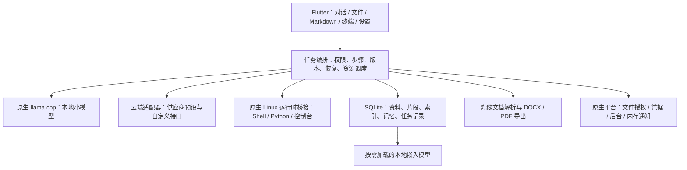

# PerAnt 个人智能体终端任务规划书

版本：0.10 · 原生浏览器与 Linux 办公接入版  
应用版本号：自 2026-11-16 起从 **0.0.1** 重新计算（当前 0.0.4+2013，功能开发阶段递增补丁号与构建号，全部功能验收后再提高主版本）；文中 0.6～0.9 均为旧编号，记录保留为历史\
日期：2026-11-13（Asia/Singapore）  
开发方式：个人配合 AI 开发，计划在 GitHub 开源  
代码许可：GNU GPLv3，工程默认标识为 `GPL-3.0-only`；第三方组件保留各自许可  
历史 0.7 交付：**0.7.0+2007** 已接入 Android 原生 WebView 浏览器与 v6 Xfce / LibreOffice。用户与模型共享电脑工作区；Linux Firefox 原型失败已移除。Android 自动化 **28/28**、Dart 223、Python 14、Android JVM 66 及格式/静态分析通过；冻结 APK 的静态校验、启动与安装一致性通过，**人工入口与往返复核已通过**。M0 双端、完整 M1-D、本地主模型、真实视觉供应商、后台和 4 GB 关卡仍未完成，见[开发状态](docs/DEVELOPMENT_STATUS.md)。

0.8 增量进度（2026-11-14）：**0.8.0+2008 网页正文资料闭环**已接入用户“保存网页文字”、模型 `browser_save_page`、固定 DOM 正文提取与根目录新建导入。完整宿主检查 Dart 252（38+214）、Python 14、格式/静态分析，另 2 项截图跳过；Android JVM 72/72、独立原生发布核心 6/6、本轮 Android **19/19**（保存 4、浏览器 5、容器 7、原生存储/文档 3）和最终 APK 静态/安装一致性已通过，最终人工保存→桌面打开流程未完成。实际保存保留同一桌面，明确截断，停止测试桌面后核对文件与独立 guest 摘要；不扩展为附件下载、上传或完整归档。见0.8 验收（`artifacts/android-browser-save-v08/VERIFICATION.md`）及[功能说明](docs/BROWSER_PAGE_SAVE.md)。下文 0.7 的测试数、APK 和截图保留为历史，不计入 0.8；M1-D09 因人工链路未完成继续保持未勾选，M0 与整体 M1-D 继续未完成。

最终 0.8 人工尝试（`artifacts/android-browser-save-v08/manual-apk-check.json`）已记录为 `incomplete`：能打开聊天和原生空白浏览器，但目标网址未成功输入/提交，未取得保存回执或在 Linux 编辑器打开的证据。输入异常与超时尚未确定根因，原始截图（`artifacts/android-browser-save-v08/manual-input-transfer-incomplete.png`）不代表成功保存。19 项设备自动化、静态及安装核验通过仍保留对应范围，不能据此将完整人工协作或 M1-D09 勾选完成。

文中标注的本地开发证据和构建产物（如 `artifacts/`、`.tooling/` 与生成的运行资源）未随本次源码发布；源码预览的验证范围以文内记录为准。

## 1. 产品定义与已确认要求

PerAnt 是运行在 Android 和 iPhone 上的个人智能体终端。用户通过对话交付材料和任务；本地小模型承担基础指令与工具调度，云端模型承担复杂规划和长文档处理；手机本地 Linux 环境执行脚本、操作任务文件，用户也能打开终端手动控制。

首个完整场景是：**导入会议文字或文档 → 整理成 Markdown → 用户查看、编辑并确认 → 本地导出 Word 或 PDF → 作为历史资料供以后检索。**产品概念参考 nanoMuse，采用独立应用设计，按许可复用组件。

| 方面 | 用户已确认的要求 |
| --- | --- |
| 用户与平台 | 先满足个人日常使用；Android 和 iPhone 都支持，任务与成果一致，底层实现允许不同 |
| 安装方式 | Android 交付可安装 ARM64 APK，以 Android 原生构建与设备/模拟器验证，不以网页预览替代；首版为个人测试安装；iPhone 最低 iOS 26；公开商店发布另行规划 |
| 本地执行 | 应用内 Linux 工作区、可视化文件与桌面入口，用户与模型共享文件和操作；模型执行命令与用户手动终端；首版不包含操作其他 App 的界面 |
| 容器电脑 | 参考小小容器，共享真实文件、终端、Linux 图形桌面、模型截图/坐标输入和用户接管；能力按对应版本设备结果验收 |
| 浏览器与办公 | 用户选择 Android 原生 WebView 浏览器整合同一电脑工作区；Linux 内接入 LibreOffice Writer/Calc/Impress。Linux Firefox 原型失败已移除，不承诺 Linux 浏览器可用 |
| 后台 | 用户启动任务后，切换 App 或锁屏时尽量继续；中断后可恢复，不要求全天常驻或准点定时启动 |
| 低配目标 | 4 GB 整机内存，优先流畅、省内存；简单本地指令约 5 秒内开始产生有效结果，必要时缩减能力或降级 |
| 按需显示 | 仅用户主动打开“查看模型电脑”且应用在前台时持续显示桌面；离开页面、切后台或锁屏时断开持续取帧，释放 Dart 像素与 Flutter 图像。模型观察使用临时单帧连接，结束后关闭；Linux 程序保留所需的内存单独计量 |
| 模型分工 | 本地开源小模型处理基础任务；云端 API 处理复杂规划、长文档和高质量创作 |
| API 设置 | 首次运行引导配置，可跳过；内置主流供应商预设，未知兼容服务可自行调整地址、模型与参数 |
| 数据授权 | 每项任务授权一次云端使用；日常操作自动执行，覆盖原件、删除和改变环境等操作确认后执行 |
| 输入与成果 | 粘贴文字、TXT、Markdown、DOCX、可提取文字的 PDF；先产出 Markdown，确认后转 DOCX/PDF |
| 材料规模 | 单任务最多 5 份材料，合计约 2 万中文字；资料库以 1,000 份文档为首版验收规模 |
| 知识与记忆 | 统一个人资料库；语义与关键词混合检索；从用户对话和确认成果自动提取记忆，支持查看、修改和删除 |
| 主交互 | 参考 nanoMuse 的对话优先界面：黑白聊天、顶部形象与状态、会话抽屉、输入框与浮动胶囊导航；资料和任务为辅助入口，保留 PerAnt 品牌 |
| 双端数据 | 独立保存，通过备份导出、导入迁移；首版不建设账户与实时同步服务 |
| 开发与许可 | Flutter 共享界面及业务，原生桥接运行时；自研代码采用 GPL，具体版本默认 GPLv3；独立应用可复用合适的 GPL 组件 |
| 功能顺序 | 近期优先丰富 Android 可视化 Linux 与模型协作；双端核心、文档、检索与记忆等仍按验收关卡推进，课件和网页完整生成工作流随后加入 |

### 规划采用的工程默认值

- 自研代码使用 **GPLv3（`GPL-3.0-only`）**。模型权重、Linux 环境和第三方组件保留各自许可、版权与必要声明，逐项检查所选固定版本的兼容性。
- Android 先面向 **64 位 ARM、Android 10 及以上**，构建时使用当时可用的稳定工具链；具体最低系统在目标真机确定后验证。
- 首版以中文为主，支持常见中英混排。首版不承担 OCR、录音转写、实时录音或原文版式的精确复刻。
- 数据默认保存在手机；API Key 放入平台凭据存储，不进入 Linux、模型提示词、日志和普通备份。
- 暂无确定实体测试机型、每周投入或截止日期，因此按验收关卡推进，不预设完成日期。当前已确认 Mac 与 Xcode 开发环境。

### 开源许可的目标与落实

GPL 用于约束受其覆盖代码的再分发：保留许可与版权信息，并按条款提供对应源码；它允许合规的复用、修改、分支和商用，不能保证不会被盗用，也不应另附“禁止商用”等相冲突的限制。应用处理或生成的个人文档不因使用 GPL 应用就自动适用 GPL。[GPLv3 正文，第 2、4、5、6 节](https://opensource.org/license/gpl-3.0)

根目录 `LICENSE` 已保存完整 GPLv3 文本。开始编写源代码时添加项目许可标识与真实版权信息；复用代码保留原作者和修改记录；发布二进制时一并提供对应版本源码、构建脚本、依赖来源和许可清单。GPL 应用的商店分发与审核仍需单独验证，首版保持个人测试安装。

## 2. 首条完整用户流程

1. 首次进入应用，查看本地模型与运行环境的下载体积、所需空间和初始化进度；可先进入工作台。
2. 选择内置 API 服务，填写 Key、选择模型，执行连接测试；也可跳过，继续使用本地基础能力。
3. 在对话中导入不超过 5 份材料，说明整理目标，例如“汇总会议议题、决策和待办”。
4. 应用完成格式识别与文字提取，显示材料范围。需使用云端时，为本项任务授权，并展示目标服务、当前材料，以及是否允许上传相关历史资料与长期记忆。
5. 智能体检索相关历史资料与记忆，提出必要的缺失信息，再调用云端或本地工具执行。界面展示真实步骤和文件变化。
6. Linux 中的脚本在任务副本上生成 Markdown。会议纪要默认包含议题、摘要、决策、待办与来源；未给出的负责人、日期等标为待确认。
7. 用户在编辑器中查看、修改，也可要求智能体继续修改；打开手动终端时，暂停智能体对同一工作区的写入。
8. 用户确认具体 Markdown 版本，然后选择导出 DOCX 或 PDF。导出期间保留该版本快照，后续修改须重新确认。
9. 确认后的成果进入资料库；低优先级任务更新检索索引，并从合适内容提取长期记忆。
10. 任务执行中可切换 App 或锁屏；系统中断时保留步骤与产物，重新打开后显示可恢复位置。

没有 API 或网络时，文件浏览、终端、本地模型基础指令、已索引资料检索、Markdown 编辑和已确认版本的本地导出仍可用。依赖云端的步骤进入等待状态，不虚构已经完成的结果。

## 3. 技术方案与首要验证关卡

### 3.1 总体架构

Flutter 负责共享界面、领域逻辑和供应商适配；Kotlin/Swift 处理平台生命周期、授权文件与后台；模型和模拟器在原生工作线程运行。模型权重及运行内存不经 Dart 复制，跨层传递状态、文本增量、文件标识和结果。采用有界缓冲与小批事件，避免逐字节刷新界面。[Flutter 平台接口](https://docs.flutter.dev/platform-integration/platform-channels)、[原生 FFI](https://docs.flutter.dev/interop/bind-native-code)

### 3.2 Linux：复用原生组件，先验证双端协作

**首版主路线：Android 使用 PRoot + Alpine 用户空间，iOS 使用 OpenMinis 的 ARM64 iSH 分支 + Alpine 用户空间。**复用相应原生集成组件，独立实现 Flutter 产品与业务层。PRoot 使用 Android 宿主内核，iSH 解释执行并转换系统调用；两者均不表示另行启动完整 Linux 内核。

OpenMinis 已有 Android PRoot/loader/PTY 和 iOS iSH 静态库、控制台、命令执行桥接源码，但它们是应用内部组件，仍需抽取、封装和验证，并非现成 Flutter SDK。许可按固定版本、源码与依赖清单保留，不能将第三方代码统一改标自研版权。[OpenMinis](https://github.com/OpenMinis/OpenMinis)、[第三方清单](https://github.com/OpenMinis/OpenMinis/blob/main/THIRD_PARTY_LICENSES.md)、[ARM64 iSH](https://github.com/OpenMinis/ish-arm64)

两端实现重点：

- **Android：**将匹配的 PRoot 与 loader 随 APK 打包，从安装后的可执行库目录启动；由 JNI PTY 提供交互终端。固定源码、工具链、产物哈希与兼容策略，验证现代目标 SDK 上的执行路径，不依赖单独安装 Termux。
- **iOS：**将 ARM64 iSH 核心、文件系统及命令/控制台接口封装为原生插件；模型在宿主原生层推理。验证内核单次启动、环境重置与应用重启之间的边界。
- **基础环境：**构建时预装 Python、证书、UTF-8 与常用命令；根据所选运行时兼容性选择仍获支持的 Alpine 版本。开发者可继续安装经验证的包，逐包记录限制。
- **文件边界目标：**仅映射当前任务副本与输出目录；正式资料库数据库、记忆和 Key 由宿主控制。PRoot 路径映射本身不证明任意命令无法访问宿主文件，该目标须通过边界测试后才能作为自主执行的依据。

Android 现有集成对 loader 配对及部分 ROM 的系统调用兼容有专门处理，因此不能任意替换二进制后假定可用；构建脚本和真机测试属于首版任务。[运行时构建脚本](https://github.com/OpenMinis/OpenMinis/blob/main/deps/build_proot.sh)、[Android 文件与启动管理](https://github.com/OpenMinis/OpenMinis/blob/main/src/android/app/src/main/java/com/openminis/app/sandbox/RootfsManager.kt)

第一关必须验证：

- 两端执行 Shell、Python、管道、子进程、中文路径及 HTTPS 请求，能获得正确退出码。
- 从应用传入任务副本，脚本写回 Markdown；重启应用后产物完整。
- 控制台可交互；任务可取消、超时，并清理其子进程或进程组。
- 模型与工具错峰运行，记录总内存、启动时间、发热及实际脚本耗时。
- 锁屏后任务尽力继续，系统到期和进程回收不会丢失已提交步骤与成果。
- 至少验证一种新增命令行工具及纯 Python 依赖的安装流程；环境变更需确认，并可重建到已知版本。
- 检查任意脚本、子进程和宿主路径是否能够绕过文件边界；未能阻断时，自动模式仅开放内置受控工具，结构化任意代码或 Shell 工具转为先展示、确认后执行；图形桌面的终端输入须在任务开始时取得包含该能力的明确授权，并展示其影响范围。

**关卡未通过时，保留失败证据并重新讨论运行时或能力边界。**普通脚本工具、远端执行或另一种模拟器不作为无提示替代。首版对 Linux 的承诺是可扩展的本地命令和脚本环境，软件包支持范围以两端实际验证为准。

### 3.2.1 可视化 Linux 与模型共控

产品参考已阅读 [Cateners/tiny_container](https://github.com/Cateners/tiny_container) 的 README：其 Android 应用包含 Linux 桌面、终端、文件访问及内置图形前端。PerAnt 保持对话优先，在同一 APK 内逐步加入共享电脑；参考功能不等于已复用对方代码或已实现同等桌面。

文件工作台通过原生 API 展示真实 `/workspace`，支持 UTF-8 编辑、目录创建、SHA256 乐观锁、Markdown 和原生静态 HTML 预览。模型文件工具按本次明确授权运行；读取内容、工具结果、桌面截图及本会话容器历史发送给选定服务。普通聊天历史与容器历史分开。结构化 Shell 工具始终展示具体命令、确认后执行；GUI 终端输入属于本任务桌面授权，不声称逐条弹出 Shell 确认。最多 12 轮模型请求／24 次工具，操作意图先落库，结果取自真实文件、截图与退出事件。取消后停止输入并释放控制权，重开只恢复记录，不自动重放。桌面运行时，结构化文件/命令 API 保持互斥，使用桌面应用或确认关闭桌面后继续。

图形桌面使用可重建的轻量桌面镜像和 X11/VNC 显示链路；模型取得实际桌面截图，并通过受控鼠标/键盘输入操作与用户相同的会话。用户接管期间模型停止输入，回交时重新观察桌面与文件变化。持续取帧和 Flutter 画面仅在用户打开“查看模型电脑”且应用前台时启用；后台、锁屏和离开页面立即释放查看器，模型需要画面时只临时截一帧。保留窗口需要 X server 和 Linux 应用继续运行，不能将查看器释放等同于全部桌面内存归零。必须验证会话启动/关闭、中文输入、分辨率、取消、文件持久化、总资源及屏幕传云授权。详见[容器电脑说明](docs/CONTAINER_COMPUTER.md)。

浏览器使用独立原生 `ComputerBrowserService` / Android WebView，与电脑应用面板和聊天“更多”共享同一页面。模型开放 `browser_open`、`browser_capture`、`browser_action`，最新 observation ID 与 native revision 绑定动作；PNG 通过 Chat Completions / Responses 实际视觉消息发送，上限 2 MiB。`browser_open` 只回执导航请求，页面是否加载须由新 `browser_capture` 的 `loading`、`error`、`page_loaded` 和实际 PNG 判断；`page_loaded` 只是观察时加载已结束且无已知错误，不证明任务内容正确。取消、接管和异步返回后重新核验控制权；不开放模型 JS 或模型关闭浏览器工具。网页下载、上传、相机/麦克风、定位及权限授予流程尚未开放，静态 HTML 预览仍保持禁脚本、禁网络的独立入口。

原生浏览器无需 Linux 查看器，但当前模型容器任务的准备阶段仍要求 Linux 基线就绪。隐藏模型观察/动作要求前台 Activity，临时挂载结束后释放 Bitmap 与 viewer，保留页面；`onPause` 不证明 JS timers、网络或 Chromium 内存停止。浏览公开页面必须符合用户任务；登录、提交、上传、发送、付款或权限操作须有针对具体动作与目的地的明确授权。

v6 办公使用官方 LibreOffice 25.8.7.3、zh_CN 与 GTK3；启动器直接调用 `soffice.bin`，显式 `URE_BOOTSTRAP`、`SAL_ENABLE_FILE_LOCKING=1`，私有配置位于 `/root/.perant-office`，文档保存到 `/workspace`。GUI 软件安装不等于宿主 DOCX/PDF 导出服务完成；Writer ODT/DOCX GUI 往返已通过，Calc/Impress 等能力仍另验，见[基础应用说明](docs/DESKTOP_APPLICATIONS.md)。

Writer、Calc、Impress 启动器仅对官方 `NORMAL_RESTART=81` 最多重试两次（总启动次数最多三次），其他退出码原样返回；argv、环境、私有配置和 stdout/stderr 均保留。3 个生成启动器语法检查与 21 个独立 Shell 功能场景已通过，见启动器检查（`artifacts/android-desktop-v07/office-launcher-shell-check.json`）；由新增 2 个 Python unittest 方法覆盖，已纳入 Python 14，不按 21 个场景再次累加，也不代替 GUI 设备验收。

### 3.3 本地主模型与资源调度

| 项目 | 首轮配置与职责 |
| --- | --- |
| 推理引擎 | llama.cpp，双端共享受支持的 GGUF 模型资源，保留 CPU 基线 |
| 首选测试模型 | Qwen3.5-0.8B，文本能力、非思考模式、Q4_K_M；初始上下文 2K，必要时比较 4K |
| 对照模型 | Qwen3.5-2B，仅用于比较质量收益与资源成本，不作为 4 GB 默认承诺 |
| 本地职责 | 简单指令理解、受限工具选择、短文本整理、查询关键词及短记忆提取 |
| 云端职责 | 复杂多步规划、长文档综合、高质量创作，以及本地能力不足的任务 |
| 调度 | 单活跃生成任务；嵌入、Linux 重任务、文档导出与本地生成错峰；需要时卸载并重建模型会话 |

Qwen 两款模型卡标注 Apache-2.0，并提供工具调用相关用法，但小模型支持工具格式不代表能够可靠执行。首版以实际中文测例决定工具范围、量化和上下文；模型文件大小不能当成运行峰值内存。[0.8B 官方模型卡](https://huggingface.co/Qwen/Qwen3.5-0.8B)、[2B 官方模型卡](https://huggingface.co/Qwen/Qwen3.5-2B)、[llama.cpp](https://github.com/ggml-org/llama.cpp)

初始化时下载或安装固定版本资源，记录来源、许可证、哈希和已安装版本。支持下载中断后继续、校验失败重试、空间不足提示及回退。完成基础资源安装后，基础工具不依赖联网临时安装。

### 3.4 后台与恢复

iOS 26 使用 `BGContinuedProcessingTask` 延续用户在前台发起的当前任务，报告真实步骤进度。系统可终止，用户从应用切换器强制关闭也会取消；不将其实现为全天守护服务。GPU 后台使用按设备和权限另验，首版保留 CPU 或暂停恢复路径。[Apple 长任务文档](https://developer.apple.com/documentation/backgroundtasks/performing-long-running-tasks-on-ios-and-ipados)

Android 使用符合任务用途的前台服务及可见进度通知，处理系统停止、Doze 和厂商后台限制；具体服务类型、启动条件和时限在真机验证中固定。[Android 前台服务](https://developer.android.com/develop/background-work/services/fgs/launch)、[Doze](https://developer.android.com/training/monitoring-device-state/doze-standby)

恢复基于持久化任务步骤和已提交产物，允许重新启动 Linux 与模型，不承诺保留活进程或完整运行态快照。网络断开、应用关闭或工具结果未落盘时，将步骤区分为“未开始、已完成、结果不确定”；不盲目重跑结果不确定的写操作。

## 4. 模型 API 预设目录与接入

这里的“API 预设目录”保存服务配置；“个人资料库”保存用户文档，两者独立。

### 首次配置流程

1. 选择已收录服务及适用地域/入口。
2. 填 Key，选择推荐模型或加载可用模型列表。
3. 测试基础文本与一个无副作用工具闭环，显示连接和工具能力结果。
4. 保存后进入对话；允许跳过、稍后修改和增加多个配置。

已收录服务默认隐藏高级字段。未知服务提供 Base URL、模型 ID、协议、认证与必要扩展参数。自定义头中的凭据同样使用安全存储；连接测试使用固定非私人文本。

### 适配原则

- 以 **OpenAI 格式**为接入边界：支持 Chat Completions，并提供 Responses 适配，供应商预设选择实际可用协议；首版不另行建设各家的原生 SDK 全功能适配。
- 预设首批覆盖 OpenAI、Claude、Gemini、DeepSeek、Qwen/百炼、Kimi、GLM、MiniMax 的可用兼容入口；对地域、模型、思考参数和工具能力分别建配置。
- 目录随应用版本更新，支持自定义覆盖。用“文档已配置 / 连接已验证 / 工具任务已验证”区分状态，缺少真实 Key 的供应商测试列为待验。
- 不把模型列表当作工具能力证明；保留工具 ID、必要的供应商扩展字段与多轮上下文，按配置处理不支持的参数。
- 任务开始时绑定服务、模型和云端授权。自动换到另一供应商需要新的授权，不将任务资料静默发送到其他入口。
- 云端授权区分“仅当前材料”和“包括允许检索的历史资料及记忆”，记录实际发送的来源与版本；仅授权当前材料时，历史检索结果不得自动加入云端上下文。后台索引与自动记忆提取默认本地执行，不沿用已结束任务的云授权。
- 记录调用次数、可获得的 token 用量和失败原因；费用只在有可靠计价配置时估算，不默认做到账单级统计。

当前 OpenAI 部分模型的工具调用要求 Responses；兼容供应商也有差异，例如 DeepSeek 思考工具调用要求保留 `reasoning_content`，Qwen 的 Key 与地域入口需要匹配。这些差异应进入预设与测试，而不是要求普通用户每次手工修复。[OpenAI 工具调用](https://developers.openai.com/api/docs/guides/function-calling)、[DeepSeek 思考模式](https://api-docs.deepseek.com/guides/thinking_mode/)、[百炼入口](https://help.aliyun.com/zh/model-studio/base-url)

其他预设的一手依据：[Claude 兼容接口](https://platform.claude.com/docs/en/cli-sdks-libraries/libraries/openai-sdk)、[Gemini 兼容接口](https://ai.google.dev/gemini-api/docs/openai)、[Kimi](https://platform.kimi.ai/docs/get-your-api-key)、[GLM](https://docs.bigmodel.cn/cn/guide/develop/openai/introduction)、[MiniMax](https://platform.minimax.io/docs/api-reference/text-openai-api)。这些资料证明有接入路径，不表示本项目已通过实际调用测试。

## 5. 文件、文档、检索与记忆

### 5.1 文件与文档

- 原始导入文件保持不可变。任务使用副本，输出先写临时文件，检查完成后发布为新版本；覆盖正式文件由应用控制。
- Android 文件 URI、iOS 授权 URL 经原生层导入工作区，不假定它们是 Linux 可直接使用的路径。
- TXT/Markdown 直接提取；DOCX 首验 Mammoth 的离线语义提取；文字 PDF 首验 pdfrx/PDFium。保留来源文件、页码或段落位置；扫描件、加密或无法提取的文件明确提示。
- Markdown 是可编辑主文档。统一 Markdown AST 驱动预览和转换；DOCX 首验 docx.js，PDF 首验 pdfmake，共享离线 JS 资源，按需创建并释放导出环境。
- DOCX/PDF 首版支持中文、1～3 级标题、段落、列表、粗斜体、链接、引用、代码块和简单表格；采用 A4 纵向与固定默认样式。中文字体离线随资源提供并保留许可。
- 不承诺输入文档版式复刻、复杂合并表格、公式或浮动图文。转换失败保留 Markdown；不静默丢弃不支持内容。

Mammoth 输出须清理后再渲染，预览和转换资源禁止加载文档中的外部脚本。以下组件仍是待双端与内存验证的宿主文档流水线候选。Android 已另行接入 LibreOffice GUI 与原生 WebView，但不以此代替宿主导入导出、双端或低配验收。[Mammoth](https://github.com/mwilliamson/mammoth.js)、[pdfrx](https://github.com/espresso3389/pdfrx)、[docx.js](https://github.com/dolanmiu/docx)、[pdfmake](https://pdfmake.github.io/docs/0.3/)、[Noto CJK](https://github.com/notofonts/noto-cjk)

### 5.2 混合检索

- SQLite 管理文档、版本、片段、记忆和索引状态；应用领域层作为业务数据库的唯一写入入口。
- 关键词检索使用 FTS5，并在原生层用 CppJieba 等宽松许可组件补齐中文分词。
- 语义检索首验 `BAAI/bge-small-zh-v1.5`，通过 ONNX Runtime 原生 CPU 路径按需加载；先比较 INT8 量化前后的检索质量。
- 文档按不超过嵌入模型输入限制分段，起始配置约 400 token、重叠约 50 token，保存原文定位。
- 向量存 SQLite；首版由原生层分批计算相似度，与关键词排名融合，默认返回最多 10 个来源片段。暂不引入独立向量数据库和重排大模型。
- 索引分批执行，优先让用户继续操作；界面显示索引进度及尚未可检索的材料。

SQLite 默认分词不足以直接完成中文搜索，不能把 FTS 当作语义检索。bge-small-zh-v1.5 是中文导向、MIT 许可的小型检索候选，英文效果与量化结果须用实际语料检查。[FTS5](https://sqlite.org/fts5.html)、[CppJieba](https://github.com/yanyiwu/cppjieba)、[嵌入模型卡](https://huggingface.co/BAAI/bge-small-zh-v1.5)、[ONNX Runtime 移动端](https://onnxruntime.ai/docs/tutorials/mobile/)

### 5.3 长期记忆与删除

- 从用户自己的对话及确认成果中自动提取短事实，包含来源、时间和版本；文档内容不能作为指令自行提升权限或直接改写系统记忆。
- 记忆入口支持查看来源、编辑、删除和停止自动提取；人工编辑过的内容不会被后续自动提取覆盖。
- 删除文档立即排除检索结果，取消待处理索引并清理片段与向量；没有其他有效来源的自动记忆同步删除。
- 人工编辑的记忆视作用户保留内容，来源删除后标记“原来源已删除”，可独立删除。
- 单独删除记忆后记录抑制标记，避免同一来源的相同记忆被自动重新提取。
- 首版备份包括文档、版本、对话、任务记录、记忆和非敏感配置；索引可重建，模型可重下载，API Key 不导出。
- 恢复前展示数据范围，采用整体替换，不做双端合并；恢复旧备份会恢复其中的历史资料与记忆。跨端迁移先重新配置 Key、授权并检查环境，再允许继续任务。

## 6. 工具权限、手动控制与接口边界

### 权限与接管

任意 Shell 无法仅靠检查 `rm` 等命令来可靠判断副作用。首版让智能体在任务副本与可丢弃环境中执行，正式资料、记忆数据库和 Key 由宿主控制。内置受控工具及符合已验证执行边界的任务脚本可自动运行；发布覆盖、删除正式文件、安装软件或改变基础环境走结构化操作与确认。若平台尚未建立任意代码的可靠边界，结构化任意脚本与 Shell 工具先展示并确认；图形桌面授权明确包含终端输入，用户应可随时停止接管，不能声称其中每条命令另有弹窗。不能把路径映射或命令预检描述为不可绕过的保护。

手动终端是明确的接管模式：暂停智能体写入，展示当前目录和任务状态；结束接管后检查文件版本变化，再由用户选择继续。环境重置和重新安装均先确认，并保留应用侧资料。运行时不被描述为已证明的强安全隔离边界。

### 最小公共接口

以下是模块间契约，具体代码在通过核心验证后建立：

| 接口 | 必须提供的能力 |
| --- | --- |
| `ModelProvider` | 流式生成、工具调用、取消、能力描述；保留协议恢复所需上下文 |
| `ProviderProfile` | 供应商、入口/地域、协议、模型配置、能力、扩展参数与验证状态；凭据仅保存引用 |
| `LocalInference` | 加载、生成、取消、卸载、资源状态；与 Linux 模块分开 |
| `LinuxRuntime` | 启停、命令执行、输出/退出码、取消、控制台输入输出、授权工作区文件交换 |
| `TaskStore` | 步骤状态、执行尝试、授权、来源版本、产物和中断原因；支持不确定结果状态 |
| `KnowledgeStore` | 导入、增量索引、混合检索、来源定位、记忆改删及删除传播 |
| `DocumentExporter` | 从已确认内容版本生成 DOCX/PDF，返回产物与格式警告 |
| `PlatformServices` | 文件授权、凭据、后台任务、通知及内存压力事件 |

任务状态至少包含：排队、运行、等待授权、等待网络、等待前台、已中断、人工接管、完成、失败和取消。恢复以步骤日志为准；副作用工具使用执行标识和产物核对，避免重复提交。

## 7. 分阶段任务清单

**清单口径（2026-11-15 按旧编号 0.8.0+2008 重写；2026-11-16 按 0.0.1 的真实模型实测更新了 M1-02、M1-03、M1-D03、M1-D07、M1-D09 与 M4-02）**：任务 ID 与原文保持不变。父项只有在全部内容按第 8 节口径验收后才勾选；子项 `[x]` 表示该部分已实现并取得括注级别的证据，`[ ]` 表示未实现或未验证。括注“模拟器”指 Android ARM64 模拟器上的原生设备测试，“宿主测试”指 `tool/check` 中使用模拟桥接或模拟 HTTP 的测试；两者都不等于实体机、真实供应商或 4 GB 验收。此后每完成一个切片，在对应子项勾选并注明版本与证据。

| 里程碑 | 父项完成 | 已有 | 主要缺口 |
| --- | --- | --- | --- |
| M0 | 0/7 | Android Linux/Python 链路、工具链与许可基线（模拟器） | 实体机、iOS、本地模型、后台、资源测量、可行性报告 |
| M1 | 0/5 | 对话工作台、API 配置、两协议网关、任务状态机与授权（宿主测试）；DeepSeek 真实对话与工具往返（模拟器，0.0.1） | 其他供应商、模型列表与多配置、步骤级恢复 |
| M1-D | 0/9 | 桌面、办公、原生浏览器、网页文字保存（模拟器自动化）；真实模型操作桌面终端与网页（模拟器，0.0.1） | 更多网页场景、多步图形任务、中文输入、实体机资源 |
| M2 | 0/5 | 四种格式导入、多资料摘录纪要、版本比较、确认后导出 | 模型归纳、Word/WPS 兼容范围与双端验收 |
| M3 | 3/5 | 语义与关键词检索、长期记忆、按需读取与逐次引用授权 | 跨端迁移及双端资料库验收 |
| M4 | 1/5 | 源码预览、构建及许可说明、本机诊断导出 | 真机压测、供应商矩阵及对应源码核验 |

### M0：真机、许可与双端核心可行性

本阶段只做验证壳、必要桥接和测量，不先建设完整产品界面。

**0.4.0 历史基线（2026-11-13）：**Android 的 Alpine/Python、JNI PTY 和固定文字→Markdown 流程已接入；0.3.0 的 Linux 集成 8/8、原生应用闭环 3/3 通过，历史证据见Python 验收报告（`artifacts/android-python/VERIFICATION.md`）。当时 0.4.0+2004 增加 **更多 → 容器电脑** 文件工作台、原生静态 HTML 预览，以及模型文件工具和逐条确认的命令协作。`tool/check` Dart **160 项**（核心/网关 38、平台/应用 122；2 项截图默认跳过）、Python **12 项**和 Android JVM **47 项**（23+13+11）通过。API 37 ARM64、target SDK 36 的原生集成共 **18/18**（容器 7、Linux 8、存储 3）。0.4.0（2004）仅 ARM64 APK 已构建、v2 签名及 18 项包内资源大小/哈希通过；min SDK 29 / target SDK 36，88,825,773 字节，已运行最终校验包，手动验证离线初始化、HTML 新建/保存及预览，见历史验收记录（`artifacts/android-container/VERIFICATION.md`）和[开发状态](docs/DEVELOPMENT_STATUS.md)。

历史 0.5.0 新增真实 X11/VNC 桌面及按需显示，见历史设备证据（`artifacts/android-desktop/VERIFICATION.md`）。历史 0.6.0 使用 Xfce 核心桌面，Android 原生集成 21/21 通过，见历史结果（`artifacts/android-desktop-v06/integration-results.json`）。0.7.0 原生浏览器 5/5 已通过，Writer ODT/DOCX 2/2、v6 桌面基线 3/3 通过，既有设备回归 18/18 通过，最终 APK 已校验并安装，人工入口与往返复核已通过，不沿用旧版通过结论。iOS iSH、本地主模型、双端真机/4 GB、后台调度与 Linux/iOS 公网 HTTPS 命令链路仍未验收，因此 M0-03～M0-05 保持未勾选。PRoot 映射不证明强隔离；结构化 Shell 逐条确认，桌面键鼠和终端输入属于明确的本任务桌面授权。来源及对应源码包要求见[Linux 运行资源说明](docs/LINUX_RUNTIME_SOURCES.md)。

- [ ] **M0-01** 确定一台 4 GB Android、一台可运行 iOS 26 的 4 GB iPhone及 Mac 开发条件，记录型号、系统、芯片、空闲空间与安装方式。
  - [x] Mac 开发环境：已用于全部 Android 构建；iOS 仅早期完成过一次模拟器 Debug 编译。
  - [ ] 4 GB Android 实体机：未确定。现有设备证据全部来自 ARM64 模拟器（API 36/37）。
  - [ ] 可运行 iOS 26 的 4 GB iPhone：未确定。
- [ ] **M0-02** 固定 Flutter、Xcode、Android SDK、原生构建工具与 GPLv3 项目声明；列出候选依赖的版本、许可、来源和可复现构建方式。
  - [x] Flutter 3.50.0 / Dart 3.14.0、Android SDK 36、NDK 28.2.13676358、JDK 基线与 `tool/` 包装脚本。
  - [x] 根目录 GPLv3 `LICENSE` 与源码 `SPDX-License-Identifier` 标识。
  - [x] Android Linux 运行资源的来源锁、许可副本与构建脚本（`third_party/linux/`、`tool/prepare-linux-runtime`）。
  - [ ] 项目版权人声明：目前只有 `tool/prepare-linux-runtime` 一处。
  - [ ] Xcode 与 iOS 工具链版本。
  - [ ] llama.cpp、嵌入模型、文档解析与导出等候选依赖的固定版本和许可清单。
- [ ] **M0-03** 抽取 Android PRoot/loader/PTY 与 iOS ARM64 iSH 原生组件，准备 Alpine/Python 基础环境，验证控制台、子进程、文件交换、取消、持久化和宿主数据访问边界；按测试结果固定自动执行范围。
  - [x] Android：PRoot、匹配 loader、JNI PTY，Alpine 3.24.4 与 Python 3.14.10 离线安装；控制台、子进程清理、中文文件名、文件交换、取消和重启后持久化（模拟器，Linux/Python 8/8，最近一次在 0.7 运行）。
  - [x] Android：文件 API 拒绝路径穿越、工作区外路径、内部任务目录和符号链接（模拟器）。
  - [x] 自动执行范围已按“隔离未证明”固定：文件工具随任务授权执行，结构化 Shell 逐条确认，桌面键鼠与终端输入归入本任务桌面授权。
  - [ ] 任意 Shell 或子进程绕过 PRoot 映射的系统性测试：现有一项受控宿主文件探测只记录事实，不构成隔离证明。
  - [ ] Linux 内公网 HTTPS 请求：只验证了 CA 可载入。
  - [ ] 新增命令行工具与纯 Python 依赖的安装、确认和重建流程：未见验证记录。
  - [ ] Android 实体机与其他 ROM。
  - [ ] iOS：ARM64 iSH 未接入，插件只返回诊断信息。
- [ ] **M0-04** 在原生层接入 llama.cpp，对比 0.8B/2B、2K/4K 上下文，测试中文基础工具指令及冷热启动。
  - 0.0.7 已接入本机 llama.cpp 和两种固定量化模型。查找资料或创建笔记时先展示操作和逐字参数，由用户确认执行。Android 模拟器与实体机的成绩分别记录。
- [ ] **M0-05** 串起“本地指令 → Linux Python 生成 Markdown → Flutter 查看/编辑 → 系统保存”的双端链路。
  - [x] Android：界面发起 → 固定 Python 脚本在任务副本上生成 Markdown → Flutter 查看、编辑、确认 → SQLite 关闭重开后可读（模拟器，原生存储/文档 3/3）。
  - [ ] 本地模型识别建笔记后，支持 Linux 的设备可以选择固定 Python 整理流程。ARM64 整链仍待实测。
  - [ ] 已确认修订可导出 DOCX 或 PDF 至系统文件。端侧识别、ARM64 Linux 与系统保存的连续验收待完成。
  - [ ] iOS 链路。
- [ ] **M0-06** 检查前后台、锁屏、断网、进程回收与恢复，并测量 UI、模型、模拟器和子进程的总资源占用。
  - [x] 重开应用后，未结束的任务与容器操作标为“已中断”，不自动重放云请求或有副作用命令（宿主测试，模拟器存储测试）。
  - [x] 桌面与浏览器查看器随页面和前后台生命周期释放连接与图像（模拟器；生命周期事件由测试 binding 注入）。
  - [ ] 真实系统后台、锁屏、断网与进程回收。
  - [ ] Android 前台服务：清单中尚未声明任何服务。
  - [ ] UI、模型、Linux 与子进程的总资源测量。
- [ ] **M0-07** 输出可行性报告与运行时决定，固定可用镜像、模型配置、基础工具范围和各模块内存预算。
  - 未开始。

**出口：**两端均完成真实链路、产物可恢复、资源可控且许可路线可执行。若 Linux、取消、持久化或低配资源无法达标，保留失败日志并调整方案；不以“能启动 demo”作为通过。

### M1：共享工作台、API 与任务内核

- [ ] **M1-01** 建立 Flutter 对话入口、任务进度、文件列表、设置及本地资源安装流程。
  - [x] 对话页、会话抽屉、多会话持久化、任务记录、资料库列表与设置页（宿主测试；0.7 最终 APK 人工入口复核）。
  - [x] Android Linux 运行资源从 APK 离线初始化，带状态提示。
  - [ ] 初始化前展示下载体积与所需空间。
  - [ ] 本地模型资源的下载、校验与安装流程。
- [ ] **M1-02** 实现首次 API 配置、跳过、供应商预设目录、自定义配置、模型选择与连接测试。
  - [x] 首次引导可跳过；8 家服务预设与自定义 OpenAI 格式入口；Key 存入平台凭据存储，配置只保存引用。
  - [x] 连接测试：固定文本的流式回复；结果以提示条显示（0.0.1，DeepSeek 实测）。
  - [ ] 加载可用模型列表：`modelsEndpoint` 已定义但未使用，模型 ID 需手填。
  - [ ] 连接测试中的无副作用工具闭环。
  - [ ] 多个配置并存：当前只保存一个 `profile`。
- [ ] **M1-03** 实现 Chat Completions/Responses 统一事件和供应商参数配置，完成流式输出及两轮工具调用。
  - [x] Chat Completions / Responses 统一流式事件、取消与脱敏错误；两协议多轮工具往返并保留续接上下文（宿主测试，模拟 HTTP）。
  - [ ] 供应商扩展参数下发：`ProviderProfile.options` 尚未传入请求。
  - [x] 一家真实供应商的流式、多轮与工具调用：DeepSeek `deepseek-chat`，Chat Completions（0.0.1；网关 `tool/live_check.dart` 5 项与模拟器应用内实测）。Responses 协议和其他供应商未测。
- [ ] **M1-04** 实现任务状态机、逐任务云授权、命令取消、结果落盘及中断恢复。
  - [x] 任务状态机与合法迁移；云授权绑定任务、服务、模型与来源版本；请求和命令取消；每步结果落盘（宿主测试）。
  - [ ] 中断恢复：目前只标记中断并要求重新发起，不能从已完成步骤继续。
  - [ ] 授权粒度：当前每条消息即一个任务、各确认一次；多轮任务只授权一次尚未实现。
  - [x] 0.0.6 的引用问答逐次展示端点及勾选原文。授权绑定每个资料修订或记忆摘要，普通对话的后续请求不复用引用上下文。
- [ ] **M1-05** 完成终端手动接管、任务文件副本、正式成果发布及破坏性操作确认。
  - [x] 手动终端接管租约：接管期间禁止聊天与模型任务；文件 API、终端与桌面互斥。
  - [x] 破坏性操作确认：删除文档、结构化 Shell 逐条、关闭桌面、切换分辨率。
  - [x] 本地文字任务在任务副本上执行，输出校验后才发布为草稿；覆盖共享文件须提交最新 SHA256。
  - [ ] 接管结束后检查文件变化，并由用户选择是否继续。

**出口：**能从对话启动简单真实任务；可见进度、可取消、可手动接管、可恢复；未配置 API 仍能使用本地基础工作台。

### M1-D：Android 图形桌面、办公与原生浏览器共控（完整关卡待验收）

0.7.0 使用 Alpine 3.24.4 v6：当前固定 355 个官方签名桌面/办公 APK、375 项运行资源，含 Xfce、LibreOffice Writer/Calc/Impress、中文字体与 PNG/XPM 兼容库。资源和启动脚本已按冻结 manifest / 最终 APK 逐项校验，375 项运行资源与 211 项许可/归属文件精确匹配源码。浏览器采用用户选择的 Android WebView，引擎与 Linux 图形桌面分开，工作区、页面和控制权由用户与模型共享；Linux Firefox 原型失败已移除。应用外层保留 nanoMuse 参考的聊天入口与按需显示。

**历史 0.7 Android 自动化 28/28 已通过，最终 APK 已校验并安装，人工入口与往返复核已通过：**完整代码检查 Dart 223、Python 14、格式/静态分析及 Android JVM 66/66 已通过；原生浏览器 5/5 通过；Writer ODT/DOCX 2/2、v6 桌面基线 3/3 通过；既有回归 18/18 通过，合计 Android 28/28；最终 0.7.0 APK 静态校验与安装一致性已通过，人工入口与往返复核已通过。0.6 的桌面 3/3 与既有回归 18/18、人工复核（`artifacts/android-desktop-v06/manual-apk-check.json`）及包体记录（`artifacts/android-desktop-v06/apk-verification.json`）仅为历史证据。长期后台、锁屏、真实视觉模型与 4 GB 设备仍未验证，以下完整条目继续保持未完成。

自动化原生浏览器 **5/5 通过**，见本轮浏览器证据（`artifacts/android-desktop-v07/native-browser-results.json`）。测试 provider 为 `com.google.android.webview / 145.0.7632.218`，使用本机 loopback 页面，未导航公网或请求真实模型；系统 IME、OS 后台调度与 4 GB 资源不在这次通过范围。

Writer 的 ODT / DOCX 真实 GUI 保存与重开 **2/2 通过**，模板保持不变，停止桌面后核对实际 ZIP/XML 与修改哈希，见办公证据（`artifacts/android-desktop-v07/office-results.json`）。v6 桌面最终基线 **3/3 通过**，见桌面证据（`artifacts/android-desktop-v07/desktop-results.json`）；生命周期由真实 Android 上的 Flutter binding 注入，不证明 OS 后台调度。Calc/Impress、复杂格式与系统中文输入法不在这两项 Writer 通过范围内。

历史 0.7 Android 自动化合计 **28/28 通过**：浏览器 5、Writer 2、桌面 3，加既有回归 18（`artifacts/android-desktop-v07/runtime-regression-results.json`）（容器 7、Linux/Python 8、原生存储/文档 3）。Linux 日志有 9 条检查记录，但对应 8 个测试用例，按 8 项计数；均在实际 Android 上执行，没有真实模型请求。最终 APK 已通过静态校验与安装一致性，人工入口与往返复核已通过。

历史 0.7 冻结交付：ARM64 调试 APK（`artifacts/apk/PerAnt-0.7.0-debug-arm64.apk`）、SHA-256 文件（`artifacts/apk/PerAnt-0.7.0-debug-arm64.apk.sha256`）；自动化总结果（`artifacts/android-desktop-v07/integration-results.json`）、包体校验（`artifacts/android-desktop-v07/apk-verification.json`）、安装一致性（`artifacts/android-desktop-v07/installed-apk-verification.json`）。版本 0.7.0/2007、仅 ARM64、min SDK 29 / target 36、v2 签名；375 项运行资源与 211 项许可/归属文件已逐项核对源码。最终 APK 通过 `--use-application-binary` 启动，设备安装字节摘要与冻结交付一致；人工入口与往返复核已通过。

最终冻结 APK 的人工入口与往返复核（`artifacts/android-desktop-v07/manual-apk-check.json`）已通过：聊天“更多”打开原生浏览器，实际显示 `https://example.org/` 正文；电脑“应用 → 文档”打开“未命名 1 — LibreOffice Writer”；“应用 → 浏览器”恢复同一 URL 和正文，页头返回后自动 RFB 重连到原 Writer。Xvnc/Xfce/Writer 进程保持不变，未修改源码或热更新。三张原始 1080×2400 PNG：聊天浏览器（`artifacts/android-desktop-v07/browser-apk-api37.png`）、Writer 入口（`artifacts/android-desktop-v07/writer-apk-api37.png`）、电脑浏览器（`artifacts/android-desktop-v07/browser-from-computer-apk-api37.png`）。返回 Writer 已实际观察但未另存截图；文档保存证据仍来自独立的两项设备测试。这次公网 HTTPS 人工观察与自动化 loopback 场景分开，不代表真实模型、系统中文 IME、长期后台或低配设备已验收。

- [ ] **M1-D01** 固定可重建的轻量桌面镜像、显示后端与第三方来源/许可；比较现有 Alpine 路线与 Debian/Xfce 路线的下载体积、启动、内存和软件兼容性，以真机数据选定方案。
  - [x] 固定 Alpine 3.24.4 v6 桌面资源：355 个官方签名包、375 项运行资源、211 项许可/归属文件，随 0.7 最终 APK 逐项校验。
  - [ ] 与 Debian/Xfce 路线的体积、启动、内存和兼容性对比。
  - [ ] 真机数据。
- [ ] **M1-D02** 在 APK 内建立真实 X11 或 VNC 桌面会话，支持启停、窗口/应用、分辨率、中文键盘和文件持久化；异常关闭后回收显示服务与子进程，不只展示静态示意图。
  - [x] APK 内 Xvnc + Xfce 会话：启停、真实窗口与应用、分辨率选择、GUI 写文件并在重启后读取（模拟器，v6 桌面 3/3，0.7）。
  - [ ] 中文输入法。
  - [ ] 异常退出后显示服务与子进程的回收：未见专项记录。
- [ ] **M1-D03** 接入模型实际截图、坐标点击、拖拽、滚动及键盘输入；按步骤返回新画面与结果。图像上传须纳入本任务目标服务与屏幕范围授权，未确认的操作不得被屏幕内容诱导触发。
  - [x] `desktop_capture` / `desktop_action`：真实 PNG、点击、双击、移动、拖拽、滚动、文字与按键；两协议视觉消息；截图计入本任务授权且不落库（宿主测试使用 fixture PNG 与模拟 HTTP；隐藏单帧观察在模拟器通过）。
  - [x] 真实视觉模型端到端的最小闭环：DeepSeek 启动桌面、双击打开终端、输入命令并读出输出，2 次均 6 轮完成（模拟器，0.0.1）。截图副本叠加像素标尺，输入回执附带新截图。
  - [ ] 多步图形任务（如用 Writer 写完并另存）：受 12 轮上限与点击精度限制，未测。
  - [ ] 屏幕内容诱导操作的防护验证。
- [ ] **M1-D04** 建立用户/模型单一输入所有权：随时停止和接管，接管后模型停止输入；交回时重新截图、检查文件变化并继续，不能回放过期坐标或重复副作用。
  - [x] 单一输入所有权：模型控制时手动输入禁用；用户接管、取消或动作消费后旧 observation ID 失效；取消只释放已按下的键和按钮（宿主测试）。
  - [ ] 交回后“重新截图 → 检查文件变化 → 继续”的完整回合，在真实模型下验证。
- [ ] **M1-D05** 在原生 APK 验证“模型生成文件→桌面应用打开→用户修改→模型重新观察并继续”的真实场景；报告截图时间、成功率、中文输入、取消、重启和 4 GB 总资源，不将静态 HTML 预览、原生浏览器用例或模拟 HTTP 测试作为 Linux 桌面和办公完整验收。
  - 未开始。需要真实视觉模型与 4 GB 实体机。
- [ ] **M1-D06** 验证按需显示：未进入查看页面时没有持续取帧；页面打开且前台才连接查看器；切后台、锁屏和退出页面后关闭连接、释放像素和原生图像句柄；模型隐藏观察临时取一帧后关闭。分别报告可见、隐藏、后台和桌面停止的资源，恢复时重新连接原会话。
  - [x] 未查看时无持续取帧；前台查看才连接；切后台或离页即释放连接、像素和两份图像句柄；隐藏观察取单帧后关闭；恢复时重连原会话（模拟器；生命周期事件由测试 binding 注入）。
  - [ ] 真实系统后台与锁屏下的行为。
  - [ ] 可见、隐藏、后台、桌面停止四种状态的资源数据。
- [ ] **M1-D07** 验证原生浏览器可见/隐藏观察与动作、真实网页脚本输入、错误页/加载状态、原生 revision / IME、接管取消、视口缩放、前后台卸载和显式关闭；截图不上永久库，不暴露任意 JS，外部提交遵守具体授权。隐藏保留会话的内存与网络单独测量。
  - [x] 原生 WebView 浏览器：可见与隐藏观察和动作、真实脚本输入、错误页与加载状态、旧 revision 拒绝、接管取消、尺寸与显式关闭（模拟器 5/5，loopback 页面；0.8 回归通过）。
  - [ ] 系统输入法（IME）。
  - [x] 真实模型操作公网网页：打开、滚动、点击链接、保存落地页（模拟器，0.0.1，DeepSeek）。最终构建连续 5 次通过；加入滚动位置回执前 7 次只通过 4 次。
  - [x] 在截图回执中提供当前滚动位置、页面长度与到顶到底标志（0.0.1）。
  - [ ] 表单输入、登录页、弹窗和脚本较重的站点：未测。
  - [ ] 公网站点与 TLS 兼容性的自动化；隐藏会话的内存与网络测量。
- [ ] **M1-D08** 验证 Writer/Calc/Impress 实际启动、中文界面、GUI 编辑、保存、停止后核对真实文件与重开；记录格式限制与版本升级影响，不把快捷键发出或包安装成功作为应用可用证据。
  - [x] Writer：ODT、DOCX 经 GUI 另存，停止桌面后核对实际文件，重开追加保存（模拟器 2/2，0.7）。
  - [ ] Calc、Impress；复杂格式；版本升级影响。
- [ ] **M1-D09** 验证用户“保存网页文字”与模型 `browser_save_page` 的实际正文提取、表单/可编辑区域/内嵌页面排除、预算截断、来源与时间、256 KiB 文件上限、最新观察及取消；在保留同一桌面窗口时只新建 `/workspace` 根目录 Markdown，核对原件不覆盖、实际文件字节和发布摘要。原生回执不是后续读回，结果不确定不自动重试；不将正文摘录当作附件下载、上传或完整网页归档。
  - [x] 用户“保存网页文字”与模型 `browser_save_page`：正文提取与排除规则、明确截断、256 KiB 上限、旧 revision 失效、保留同一桌面会话、只新建不覆盖、读回摘要一致（模拟器 4/4，0.8）。
  - [x] 人工“输入网址 → 保存”：公网页面首次保存成功，文件可在终端列出（模拟器，0.0.1）。此前“第一次保存总是失败”的根因已查明并修复：保存提示行改变了网页视图尺寸，被原生层当成页面变化；地址栏进入时也改为全选原网址。
  - [ ] 在 Linux 桌面编辑器中打开已保存的文件：未做。0.8 记录的宿主键盘输入丢字未复现，也未单独排查。

**出口：**用户与模型可在手机内查看并操控同一真实 Linux 桌面，会话关闭可确认、产物可恢复，授权和输入接管可追溯；未达低配预算时降低桌面配置或按需启动。

### M2：文档与会议纪要闭环

- [ ] **M2-01** 支持粘贴/TXT/MD/DOCX/文字 PDF，记录来源定位、格式问题及单任务材料范围。
  - [x] 粘贴文字（单轮 2 万字上限）；TXT/Markdown 导入资料库（0.0.3 统一为 10 MB、2 万字上限）。
  - [x] DOCX 正文按段落提取，文字 PDF 按物理页提取。Android 设备回归覆盖离线生成的中文样本。iOS PDFKit 路径待真机核验。
  - [x] 本机纪要选择 1 至 5 份、合计最多 2 万字的版本。提取结果保留段号或页码，标示空白页、扫描件和超限。
- [ ] **M2-02** 完成会议纪要/资料整理工作流，支持长材料分段与汇总，避免静默截断。
  - 0.0.3 已能按原文标记提取议题、决策和待办候选，其余原文保留，引用绑定文档、修订和行号。0.0.7 可用本地模型分段归纳并逐层汇总，输出保留每段字位和来源修订；人工纪要质量评测仍待完成。
- [ ] **M2-03** 完成 Markdown 编辑、预览、版本与智能体修改后的差异检查。
  - [x] Markdown 编辑与预览；每次修改递增修订号（宿主测试）。
  - [x] 保存历史修订、逐字差异、恢复为草稿，并在保存时检查编辑起点的修订号。
  - [x] 0.0.7 在编辑器中对最多 320 字提出本机润色建议，展示字级差异；用户采用后进入草稿，另行保存并检查修订。
- [ ] **M2-04** 将确认绑定内容版本，离线导出 DOCX/PDF，验证中文字体、表格和分页。
  - [x] 确认绑定具体修订，再次编辑后确认失效；导出只接受已确认快照（领域层，宿主测试）。
  - [x] 已确认修订可离线写成 DOCX 和嵌入中文字体的 A4 PDF。样本覆盖长段、跨页表格及混合文字。Microsoft Word 16.0 已验证编辑单元格、另存及重开。WPS 和 iOS 系统保存待验收。
- [ ] **M2-05** 按 5 份、合计 2 万中文字的样本集执行双端完整验收。
  - 未开始。

**出口：**能得到忠于材料、可编辑、可确认导出的实际文档；转换和网络失败不会丢失原件或草稿。

### M3：统一知识库与长期记忆

- [ ] **M3-01** 建立 SQLite 文档/版本/片段/记忆模型，完成中文关键词索引与来源跳转。
  - 0.0.5 已接入 SQLite 中文单字、双字及拉丁词索引。结果带版本、片段和原文偏移。记忆随同一 SQLite 工作区快照保存。
- [x] **M3-02** 接入本地嵌入模型及混合检索，分批索引，证明同义改写可召回相关资料。
- [x] **M3-03** 自动提取记忆，完成来源展示、人工修改、删除抑制和文档删除传播。
- [x] **M3-04** 已接入逐次授权的资料问答，每轮最多 5 段、合计 2,000 字，语义检索分批读取向量。0.0.8 在 SQLite 冷启动读取修订目录，在打开、比较或导出时按需读原文；查询和引用确认只读有界的重叠片段。
- [ ] **M3-05** 完成跨端备份/导入与完整恢复验证，以 1,000 份固定文档做性能测试。

0.0.5 的备份包含记忆、人工修改、自动提取开关和同源删除抑制标记。已能读取旧版备份。提取采用本地明确陈述的短句规则，限用户消息和已确认文档。自动记忆随来源删除，人工编辑的记忆保留并标明原来源已删除。跨端迁移仍待验收。0.0.6 已加入离线嵌入模型、关键词混合排名和显式选择后引用历史资料。

Android API 37 x86_64 模拟器的固定语料包含 1,000 份长短文档、重复材料、少量英文，共 5,000,000 个字符、12,169,540 字节。SQLite FTS4 生成 18,500 个片段。50 个有准确出处的关键词全部在前五条中命中，另测了查无结果、修订替换和来源删除。生成方式与复测入口见 [设备测试](apps/perant/integration_test/library_search_test.dart)。该组成绩仅衡量关键词。

**出口：**历史材料可被语义与关键词共同找到，回答有来源；修改、删除和备份恢复后结果一致。

0.0.6 于 Android API 37 x86_64 实测 BGE INT8。固定合成语料的 1,000 份资料合计 500 万字符，生成 18,575 个片段，大量重复背景资料按内容复用为 92 个不同向量。暂停后继续，建立全部向量用时 19.202 秒。50 个有标注的改写问题在相同语料中，纯关键词 Top-5 为 0/50，混合结果为 49/50，5 个无答案问题均返回空。查询 P50 为 376 毫秒，P90 为 388 毫秒，最长 411 毫秒。此组语料用于回归，不代表真实用户资料的分布。复现入口为 `integration_test/semantic_search_test.dart --dart-define=PERANT_LARGE_LIBRARY=true`。

### M4：个人日常使用版与开源交付

- [ ] **M4-01** 完成低内存、后台、下载中断、磁盘不足和取消压力测试，按真机数据优化。
  - 未开始。
- [ ] **M4-02** 为有测试凭据的预设服务执行兼容矩阵，将未测试入口明确列出。
  - [x] DeepSeek：对话、工具调用、图像输入（0.0.1，模拟器实测）。
  - [ ] 其余 7 家预设与 Responses 协议均未用真实 Key 测试。
- [ ] **M4-03** 提供本地诊断日志导出，清理凭据与私人原文，默认不建设远程遥测服务。
  - [x] 文件页可导出本机诊断 JSON。仅列出计数、平台与最近各 100 条任务或操作的时间及枚举状态。
- [ ] **M4-04** 整理构建、个人安装、模型/镜像资源、GPLv3 对应源码和第三方许可、版权及修改记录；保留本地可复现检查，不启用 GitHub CI 测试。
  - [x] 构建与个人安装说明、`tool/check` 本地检查、Linux 运行资源的第三方许可与来源记录。
  - [ ] Alpine 等 Linux 二进制的完整对应源码包：公开分发二进制前必须补齐。
  - [ ] 项目版权人声明与修改记录。
  - [ ] 模型资源说明（依赖 M0-04）。
- [x] **M4-05** 在用户指定 GitHub 仓库后单独发布开源代码；本规划不自动创建仓库或上传资料。
  - 源码预览已于 2026-11-14 发布到 GitHub `W1nnnd/PerAnt`；未附 APK 与 Linux 二进制，`artifacts/` 中的证据未随仓库发布。

**出口：**开发者能按文档重建、安装和复现验收场景，个人能够连续日常使用，已知限制可查。

### M5：后续能力

0.0.4 已跑通「PerAnt 入门」课件样本。确认后的资料生成独立 Markdown 大纲，修改再确认后导出原生文本框。Microsoft PowerPoint 16.0 已打开五页课件、修改第三页正文、另存并重开。相同资料可生成单文件 HTML，Android 工作文件编辑器提供源码编辑和静态预览。课件当前面向文字材料，网页导出保留结构和文本，外链及图片仅保留说明。

先选一个真实课件案例，完成“参考材料 → 大纲 → 用户确认 → 可编辑 PPTX”；再选一个网页案例，完成“参考 → 页面文件 → 本地预览 → 修改”。图片理解、参考稿还原、额外模型接口或依赖只随具体案例加入。网页公开部署、录音/OCR、手机其他 App 自动化及数据同步另行立项。

## 8. 验收标准与测试口径

| 项目 | 验收方式 |
| --- | --- |
| 简单本地指令 | 固定不少于 50 条短中文指令，涵盖文件查找、建笔记、单工具参数等；以正确动作开始或首个有用结果计时，目标约 5 秒，报告 P50/P90、成功率及失败原因，打字动画不算结果 |
| 冷热状态 | 分别记录模型已加载、已卸载后的首条指令、Linux 冷启动和模型重载；不将慢启动样本从报告中隐藏，未达目标时缩减本地工具范围、提供手动路径，或经授权转云端 |
| 工具质量 | 自动执行的基础指令目标正确率至少 95%；参数必须校验。低置信、非法参数或能力不足时澄清/降级，不把错误调用算成功 |
| 4 GB 资源 | 统计应用原生、Dart、模型、Linux 工具及附加渲染进程；M0 固定各场景预算，连续压力运行不反复被系统回收；权重大小不作为峰值内存 |
| 首个文档任务 | 两端均支持 5 份、合计约 2 万中文字；无静默截断，原件不变，Markdown 可修改和确认 |
| 导出 | DOCX 在 Word/WPS 中可继续编辑；PDF 文字可选中检索；中文无缺字，长段落/简单跨页表格不裁切，确认版本与导出内容一致 |
| 知识库规模 | 固定 1,000 份、约 500 万中文字的混合测试语料，记录实际字数、体积及片段数；包含少量英文、长短文档和重复材料，该规模不是永久文件数上限 |
| 检索质量 | 至少 50 条标注查询，含两字中文词、同义改写、文档更新与无答案；Top-5 命中目标至少 90%，正常查询结果展示目标约 2 秒，索引未完成时明确显示范围 |
| 长期记忆 | 来源可查，人工修改不会被覆盖，删除后不从同一来源重新出现，资料删除后不存在失效检索残留 |
| API 兼容 | 每个标为已验证的入口通过文本流、单工具、两轮工具、多工具结果、非法 Key、限流、超时和断流测试；没有 Key 的入口保持待验证 |
| 后台与恢复 | 双端覆盖切 App、锁屏、系统到期、断网和进程终止；允许后台中断，但已提交文件和步骤不丢失，不重复执行结果不确定的副作用操作 |
| 手动接管 | 同一文档不被用户编辑、终端与智能体同时覆盖；接管后检查变化，恢复执行前重新核对版本；完整桌面阶段验证单一输入所有权和过期截图/坐标拒绝 |
| 容器工作台 | 在真实 Android APK 验证目录、UTF-8 文件、SHA256 冲突、终端互斥、静态预览与两协议工具结果；脚本 MockClient 不算真实服务兼容，平台视图挂载不算像素内容验收 |
| 完整 Linux 桌面 | 真实桌面会话、应用窗口、模型截图/鼠标键盘与用户接管闭环；同时报告显示服务、渲染进程、Linux 和模型的资源占用，关闭后无遗留会话 |
| 原生浏览器 | 在 Android APK 验证同一 WebView 的真实 PNG、视口坐标、revision/IME、隐藏按需观察、取消接管及关闭；不以静态 HTML 预览或宿主浏览器替代 |
| 文件与云授权边界 | 测试脚本/子进程绕过文件映射的情况，未具备可靠边界时禁止自动执行任意代码；仅当前材料授权的任务不上传历史资料或记忆，调用记录可追溯实际来源版本 |
| 备份迁移 | Android → iPhone 与反向导入各通过一次；中文路径、文档版本和记忆完整，Key 不随普通备份泄露，失效授权重新取得 |

表中成功率、检索延迟和语料总字数是本规划的工程默认验收目标；用户明确提出的 4 GB、约 5 秒、5 份/2 万字和 1,000 份规模保持不变。实际设备未确定前，均不能宣称已达标。

## 9. 风险、前置条件与推进规则

| 风险或缺项 | 处理方式 |
| --- | --- |
| Flutter、原生模型与双端 Linux 的联合表现尚未获真机证明 | Android 工作台每个增量先做原生验收；M0 继续验证 PRoot/iSH、模型与资源，双端证据作为完整产品出口条件 |
| GPL 被误解为禁止复用或商用 | 保留版权、许可和对应源码，明确其允许合规复用的边界；逐项核查第三方固定版本 |
| 完整 Linux 桌面与极简低配存在取舍 | 桌面按需启动，先固定轻量镜像、显示后端和软件范围；将显示、模型、Linux 与渲染进程一并计入 4 GB 验收，根据数据调整桌面配置 |
| 小模型工具可靠性与 5 秒目标冲突 | 缩小基础指令/工具集合、控制上下文和输出；本地不足时澄清或使用已授权 API |
| 模型、Linux、嵌入与导出内存叠加 | 共享资源调度、串行重任务、按需卸载；以平台总占用与回收行为验收 |
| iOS 后台调度或 Android 厂商限制 | 真实进度、步骤检查点、暂停/恢复；保留平台差异，不承诺永不停止 |
| 接口与模型持续变化 | 版本化预设、能力配置和回归矩阵，保留自定义入口；按测试状态描述支持范围 |
| 测试设备、Mac、投入时长待定 | 作为 M0-01 的前置任务；条件明确后再估工期和成本，不将资源未知换算成日历承诺 |

个人配合 AI 开发时，每次以一个任务 ID 为工作单位：读取本规划和已有实现 → 完成最小可验证切片 → 执行对应测试 → 记录产物与结果 → 再进入下一项。共享协议、可迁移数据格式和运行时决定应先记录，再让不同 AI 任务并行实现。涉及原生桥接、后台或内存的结论以真机证据为准。

**下一步先扩大 M1-D 真实模型的网页与多步图形任务覆盖，再做中文输入与低配资源，然后接本地主模型。M0 的实体测试机、双端运行时、后台调度和 4 GB 验证继续作为完整产品出口条件。**

## 10. 从 0.0.1 开始的迭代顺序

下一轮聚焦一次完整的资料整理。用户让小蚁找到一份网页资料，保存到工作区，在桌面打开，自己改一句话，再把控制权交还给小蚁。0.0.1 的最终构建在同一网页任务上连续成功 5 次。已有 Writer 自动化验证了保存与重开，用户修改后交还模型的完整过程仍待验证。[0.0.1 实测记录](docs/releases/0.0.1.md)

### 第一轮的交付与验收

| 顺序 | 已有任务 | 本轮做什么 | 怎样判定结果 |
| --- | --- | --- | --- |
| 1 | M1-D07、M1-D09 | 复用现有 WebView 和网页保存集成用例。保留原来的长页作为对照，再准备正文延迟出现的页面和有中文输入框的页面。每个页面放入可核对的正文与来源。 | 在同一候选 APK 上分别记录设备测试和真实模型操作。核对长页滚动后的正文、延迟显示的指定段落及其来源，检查中文表单草稿是否被排除。每次成功保存只新增一份文件。 |
| 2 | M1-D09 | 保持桌面打开，从网页保存回执取得路径，在同一桌面的文本编辑器中打开该文件。比较网页标题、来源和一段已知正文。 | 桌面会话保持，文件能从回执路径打开，用户看见的正文与样本一致。取消或保存结果不确定时，检查已有产物，避免重复创建。 |
| 3 | M1-D03 至 M1-D05 | 在 Writer 里走一遍接管流程。模型创建文档，用户接管并改一句中文，交回后模型根据新画面继续编辑，另存并重开。 | 重开文件能同时找到用户和模型新增的两段文字，原件仍在。接管期间无延迟模型输入，交回后的首个动作使用新观察。记录轮数、误点和重试，保留现有 12 轮、24 次工具调用预算作为比较基线。 |

第一个开发任务是扩展现有网页保存用例。保留已有的 SPA 地址变化测试，新增一个地址始终不变的页面，先显示占位内容，再由受控事件切换为含指定中文段落的正文。任务要求保存该段落。设备测试在内容出现后执行保存，核对文件里的正文和来源。真实模型独立决定何时保存，同一构建上另跑原长页作对照。若模型提前保存，按观察、操作、写入三步定位原因。记录模型、协议、尝试次数与逐次结果，单独保留失败样本。

**延迟正文用例的复测入口。** 设备用例由测试页发出正文已更新的信号，分别检查 WebView 能否读到新段落，以及保存后工作区是否只新增一份内容、来源和摘要均正确的文件。[原生浏览器用例](apps/perant/integration_test/computer_browser_test.dart) · [工作区保存用例](apps/perant/integration_test/browser_page_save_test.dart)

真实模型复测时，在仓库根目录运行 `tool/dartw apps/perant/integration_test/fixtures/delayed_article.dart`，在已连接的测试设备上使用脚本打印的 `adb reverse` 映射。在电脑协作入口发送“打开这个地址，等会议决定公布后保存网页文字，把文件路径给我”，附上脚本打印的网址。这个模式在页面加载后约五秒发布正文，由模型决定保存时机。按回执打开文件核对实际决定和来源，记录提前保存、遗漏或重复创建。[测试页](apps/perant/integration_test/fixtures/delayed_article.dart)

### 0.0.2 模拟器验证（2026-11-20）

在 Windows x86_64 的临时 Android API 37 模拟器（4 核、4 GB 内存）上，未安装 Linux 时也能保存网页并打开工作文件。页面收到中文输入事件后，测试核对 Markdown 中的公开正文与来源、草稿排除、唯一文件和摘要，再修改中文、重开并尝试用旧摘要写回。每轮仅清理本轮生成的文件。

在文件编辑界面的 30 轮连续运行中，30 轮均通过，最终候选构建的端到端中位数为 4.149 秒，P95 为 4.218 秒，最长 5.067 秒。这包括打开测试页、输入、保存、编辑、重开和冲突检查。模拟器使用 Android System WebView 145.0.7632.218。要复测，可在应用目录对专用测试设备运行 `../../tool/flutterw test integration_test/computer_browser_test.dart -d <设备ID> --dart-define=PERANT_WORKSPACE_STRESS_ROUNDS=30`。

本机 Emulator 37.3.10 拒绝在 x86_64 宿主启动官方 API 29 ARM64 镜像，现有 x86_64 镜像的 ARM 转译也未能完成离线 Linux 安装。下一项仍需在原生 ARM64 Android 上完成同一桌面打开回执路径、Writer 中文接管和重开，并单独记录真实模型的操作结果。

### 后续制作方向与进入条件

| 方向 | 开始条件 | 首个可交付结果 |
| --- | --- | --- |
| 中文输入、低配与恢复（M1-D02、M1-D06、M0） | 网页和桌面样例固定后即可采数。系统输入法和整机资源在实体 Android 手机上验证。 | 测中文候选词、选中替换、撤回与重开。复测历史 3 GB 模拟器冷安装超时，再单列 4 GB 真机的安装耗时、磁盘和峰值内存，比较桌面可见、隐藏、后台和停止四种状态。用结果选定最先优化的环节。 |
| 本地小模型与双端可行性（M0） | 已取得 Android 基础运行时资源数据。取得 iPhone 和相应构建环境后可并行验证 iOS。 | 在 4 GB 设备上用至少 50 条固定中文短指令记录正确率及首个有效结果的 P50/P90，对照约 5 秒目标。iOS 先完成一条离线命令和文件往返，分别记录锁屏、系统中断与恢复行为。 |
| 会议纪要与可编辑交付（M2） | 控制权交回和文件版本已能可靠核对，可先复用现有 TXT/Markdown 输入。 | 用会议原文生成带来源的决策和待办，用户修改、确认后从该修订离线导出可编辑 DOCX。随后增加文字可检索的 PDF，以及最多 5 份、合计约 2 万中文字的多材料验收。 |
| 资料检索与长期记忆（M3） | 文档、修订、来源及删除规则稳定。 | 先提供带来源跳转的中文关键词检索，再以同一组问题比较混合检索的增益。沿用 1,000 份资料、至少 50 个标注查询及 Top-5 命中率 90% 的既有目标，同时验证更新和删除后的结果。 |

每轮冻结候选 APK 后，随结果记录构建号、设备或模拟器配置及测试入口。新增模型服务先用同一个代表任务验证，分别记录 Chat Completions 与 Responses。产品发布以当次构建和对应源码为单位，下一版本号和发布日期在验收后确定。
