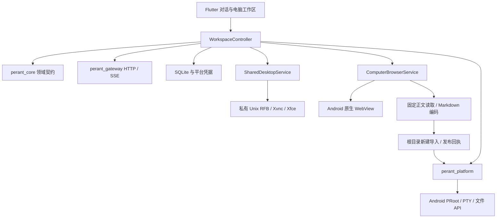

# 架构说明

当前源码：**0.8.0+2008 / Android 网页正文保存到共享工作区**。沿用 v6 Xfce、LibreOffice 与原生 WebView，新增固定正文读取、Markdown 编码和专用根目录新建导入。宿主检查、Android JVM 72/72、原生共享 C 核心 probe 6/6、本轮 Android 集成 19/19 及最终 APK 静态/安装一致性已通过；最终人工保存→桌面打开流程未完成。历史 0.7 设备记录不能代替新增链路，M0 双端和完整 M1-D 仍未完成。

文中标注的本地开发证据和构建产物（如 `artifacts/`、`.tooling/` 与生成的运行资源）未随本次源码发布；源码预览的验证范围以文内记录为准。

## 模块边界

- **`perant_core`** 不依赖 Flutter，定义任务迁移、云授权、文档确认版本、来源与运行时/知识库契约。契约存在不表示对应能力已接入。
- **`perant_gateway`** 仅负责 OpenAI 格式 HTTP/SSE 与流式事件归一化，不执行工具。Key 调用时注入，必要协议扩展与 reasoning 上下文保留；只有完整终止事件才表示响应结束。
- **`perant_platform`** 连接 Android Linux、结构化文件、RFB、原生浏览器与静态 HTML 视图。Linux 控制使用 `dev.perant/runtime` 与事件通道；浏览器使用独立的 `dev.perant/browser` 和 `dev.perant/computer-browser` 平台视图。iOS 当前只有能力诊断，未接入 iSH 或浏览器共控。
- **`apps/perant`** 管理对话、配置、授权、任务/工具循环、持久化和用户接管。用户与模型共享同一桌面服务和浏览器服务，不为模型另开隐藏会话。聊天状态卡只读取状态，不自动截图或启动应用。

## 状态、授权与恢复

SQLite 保存文档、会话、任务、工具回执和非敏感配置；不保存 PNG、像素缓冲、X11 cookie 或可重放的实时连接。Key 使用平台凭据存储，普通配置只保存引用。当前没有向量索引、长期记忆或完整迁移备份。

文档确认绑定具体版本，编辑后旧确认失效。任务重开后未完成操作标为中断，不自动重放云请求、命令或表单提交。协议连续上下文保留在内存；普通聊天与容器协作使用不同历史键，普通请求不自动带入容器内容。容器授权明确目标服务、当前任务和允许发送的共享文件、桌面/浏览器画面、工具结果及容器历史。

`WorkspaceController` 编排完整模型回合，再验证 call ID、工具名与参数，保存意图后执行。最多 12 轮模型请求、24 次工具；累计文本结果 512 KiB、文本上下文 1 MiB。Chat Completions 保留 assistant `tool_calls`、扩展与 `tool_call_id`；Responses 保留 reasoning/function_call，并用 `function_call_output.call_id` 对应结果。整批工具回执连续返回后才附最新视觉消息，旧截图从请求中移除，跨任务历史不保留图片。

文件内容、网页、截图、标题、输出和错误都只是任务数据。网页不能授予新权限。结构化 `container_run_command` 逐条确认；桌面键鼠授权包含 GUI 终端输入。登录、上传、发送、提交、付款及权限授予需要用户对具体行为与目的地的明确授权。

## Android Linux 与办公应用

运行时为 `perant-alpine-3.24.4-aarch64-v6`：固定 PRoot、匹配 loader、原始 Alpine minirootfs、Python 3.14.10 和官方签名桌面/办公包。当前 manifest 含 **355 个桌面/办公 APK、375 项运行资源**；Python 包、rootfs、原生库、兼容库与脚本分别计入资源。最终字节数和摘要以冻结清单、离线校验与交付包体记录为准；包体积不能替代进程 RSS 测量。

首次初始化在 v6 staging 中用 `apk add --no-network` 和 Alpine 原有公钥校验包，完成实际二进制与图像解码自检后原子发布。旧运行时版本与独立 `/workspace` 保留。PRoot/loader 从 APK 可执行库目录启动；rootfs gzip 原始字节不变。来源、许可和重建输入见[运行资源说明](LINUX_RUNTIME_SOURCES.md)。

Xfce 核心包括 Xfwm4、Panel、Xfdesktop、Thunar、Xfce Terminal、Mousepad、设置及中文字体；LibreOffice 25.8.7.3 提供 Writer、Calc、Impress、zh_CN 与 GTK3 集成。启动器直接调用官方 `/usr/lib/libreoffice/program/soffice.bin`，明确 `URE_BOOTSTRAP`，设置 `SAL_USE_VCLPLUGIN=gtk3`、`SAL_ENABLE_FILE_LOCKING=1`，使用 `/root/.perant-office` 私有用户配置。文档工作目录和默认保存位置为 `/workspace`，不把私有配置与恢复信息当作任务产物。Writer ODT/DOCX GUI 保存及重开已通过 2/2，Calc/Impress 和复杂格式仍待验收，应用和快捷键见[基础应用说明](DESKTOP_APPLICATIONS.md)。

Writer、Calc、Impress 启动器仅对官方 `NORMAL_RESTART=81` 最多重试两次（总启动次数最多三次），其他退出码原样返回；argv、环境、私有配置和 stdout/stderr 均保留。3 个生成启动器语法检查与 21 个独立 Shell 功能场景已通过，见启动器检查（`artifacts/android-desktop-v07/office-launcher-shell-check.json`）；由新增 2 个 Python unittest 方法覆盖，已纳入 Python 14，不按 21 个场景再次累加，也不代替 GUI 设备验收。

Linux Firefox 原型在当前环境中运行失败，已从 v6 资源移除。交互浏览器采用 Android 原生 WebView；不再把 Linux Firefox 或 Super+B 作为可用桌面应用宣传。

同版本 GdkPixbuf 2.44.7 源码构建的 PNG/XPM 兼容库经 manifest/ELF/摘要校验安装至 `/opt/perant/lib`，只在 guest 桌面进程树设置库搜索路径。官方 APK 签名字节不改；初始化实际解码固定 PNG/XPM 后才就绪。构建使用固定依赖与离线 ARM64 Docker，源码和 LGPL 声明分别保留。

原生 guest 控制与文件变更走 FIFO 生命周期队列，PTY 输入、读取和 waitpid 使用独立执行器。输入在锁内复制 fd、锁外完成阻塞写入；关闭排在已接收的启动之后。事件按任务/会话 ID 匹配，调用方先订阅并确认通道，再启动进程。取消只有真实退出或 FIFO 清理确认后才释放占有；回执不确定时等待屏障，不自动重试副作用。

固定 Python 文本任务只执行 manifest 脚本，原文写入 JSON，不拼入 Shell。输出验证后把 Markdown 草稿、任务与回执作为同一快照保存；取消或失败不发布完成文档，见[文字任务](PYTHON_TEXT_TASK.md)。本地推理仍待宿主原生层接入，避免在 Linux 内重复运行推理。

## Linux 图形显示与共享文件

`LinuxDesktopLaunch` 使用短随机私有目录，绑定 guest 的私有 `/tmp` 和 `/run/perant-desktop`。Xvnc/RFB 只监听权限 0600 的 Unix socket，X11 TCP 关闭，Xauthority 每次启动随机。固定脚本等待真实 Xfce 会话、窗口管理器以及 panel/desktop 可见窗口就绪后发布 `perant-desktop-v6` marker；原生核验普通文件、完整内容与实际 RFB banner。

`SharedDesktopService` 连接同一 Xvnc 会话。用户前台查看时持续读取 Raw/CopyRect；离页或后台立即断开显示连接，清空 Dart 帧并释放当前、待回收及 RenderImage 克隆句柄。迟到连接和解码回调不能重新发布后台画面。模型 `desktop_capture` 只临时取一帧，`desktop_action` 的输入连接不请求像素；GUI 窗口仍在 Linux 中保留，也继续占内存。

手机首次查看默认为 720×1080 竖屏或 1120×700 横屏；既有会话不因旋转重启。改分辨率需确认关闭并重启。独立模型 `desktop_start` 默认 1024×640。查看器支持实际键鼠、长按右键、拖动、缩放、全屏和快捷操作；中文输入法及 4 GB 实体设备资源仍待验证。

`ContainerScreen` 与 `ContainerFileEditor` 使用原生共享文件 API：规范 `/workspace` 路径、有效 UTF-8、无 NUL、最多 256 KiB，拒绝穿越、链接、内部任务目录与特殊文件。目录最多 500 项，模型最多 100 项；新建排他、覆盖需最新整文件 SHA256，先写临时文件再原子发布。截断读取和跨任务旧哈希不能授权覆盖。

通用原生文件 API、手动终端与受控 Python 和活跃 guest/桌面互斥；桌面运行时通过 GUI 操作，或确认停止后访问文件工作台。专用 `importLinuxTextFile` 是新建正文产物的独立入口：仅允许已安装且空闲或桌面已就绪的运行时，不开放活跃 guest 下的通用文件编辑。PRoot 不是强隔离，任意已授权 Shell 不等同于受控文件 API 的路径限制。系统后台、锁屏续跑和完整进程恢复尚未接入。

## 原生浏览器与模型工具

`ComputerBrowserService` 管理一个 Android WebView 会话、串行操作、控制权代次和单次观察；`ComputerBrowserScreen` 提供地址栏、历史导航、“保存网页文字”、接管及用户显式关闭。电脑应用面板和聊天“更多”进入同一页面。原生 `ComputerBrowserRuntime` 把同一个 WebView 挂到查看器，隐藏观察时按需临时挂载；不创建另一个模型浏览器。

`ContainerBrowserAgent` 是可注入接口，生产适配器调用共享服务。`browser_open` 仅接受无内嵌凭据的 HTTP(S) 或 `about:blank`；`browser_open` 的成功回执仅表示已请求导航，不表示页面已加载；`browser_capture` 返回实际 PNG、URL、标题、revision、loading、error、page_loaded 和 observation ID；`browser_action` 支持 tap、long_press、scroll、text、key。动作使用最新未消费观察与 native `expectedRevision`，用户接管、取消、过期和页面/输入变化使旧观察失效。截图和操作的异步结果必须重新检查控制权，控制器在新 HTTP 前再次检查图片所属授权。

`browser_save_page` 消费同一浏览器最新未消费的观察，调用原生 `readPage` 固定 DOM 遍历；不接受脚本或任意路径。原生读取前和回调后核对会话、前台、URL、revision 及加载错误，排除表单、可编辑区域、内嵌页面、脚本和隐藏节点。正文最多 120,000 个 UTF-16 代码单元且 UTF-8 最多 240 KiB，节点、扫描及时间预算触限也明确 `truncated`。`browser_page_document.dart` 将正文按文字转义，连同标题、来源、UTC 时间和截断提示，总 UTF-8 预算为 256 KiB；不是完整归档或附件下载。

`LinuxWorkspaceImport` 生成固定根目录名 `web-<UUID>.md`。生产 JNI 与独立探针共用 `workspace_import.h` 核心：固定目录 fd、不跟随链接、应用私有暂存、排他创建、完整写入/同步和 `renameat2(RENAME_NOREPLACE)` 发布，已存在目标不覆盖。回执从本次发布字节生成路径、大小和 SHA256，不重新读取可能已被桌面应用修改的路径。此操作使用原有 FIFO/生命周期锁；通用目录和文件编辑 API 仍要求 idle。

正文读取前后及发布前检查控制代次，旧观察单次消费。取消不能回滚已经发布的文件；原生发布结果不确定时通过同 FIFO 完成屏障等待，并停止后续工具和云请求，不自动重试。成功回执持久化失败也停止后续请求，避免模型重复创建。范围见[网页文字保存](BROWSER_PAGE_SAVE.md)。

截图回执 `ok` 只说明捕获成功，错误页面也会提供实际 PNG。`page_loaded` 仅表示该次观察的 loading 为 false 且没有已报告 error，不证明页面内容符合任务或所有资源正常；模型须核对实际画面，不能只凭打开回执宣告加载成功。

浏览器截图是按需输出，PNG 上限 **2 MiB**，以 Chat 的 `image_url` 或 Responses 的 `input_image` 发送；视口状态与按比例缩小的 PNG 尺寸分开，动作按截图到实际视口映射。截图 Bitmap 在返回后释放，不用定时截图驱动查看器。隐藏卸载 viewer、停止连续截图并释放 Bitmap，保留页面会话；`onPause` 不保证 JavaScript timers、网页网络停止或 Chromium renderer 内存归零，显式关闭才销毁。按需观察和操作要求前台 Activity；隐藏查看器可按需执行已在本轮原生浏览器用例验证，不等于后台浏览器守护。

WebView 保持证书错误拒绝、禁止混合内容，禁用 file/content 访问；网页相机/麦克风、定位、文件选择、下载和新窗口流程不开放。JavaScript 用于正常网页运行，模型接口不暴露任意脚本执行。模型没有 `browser_close`；用户关闭需明确确认未提交表单可能丢失。网络策略允许远程 HTTPS，明文 HTTP 仅用于 loopback，本地页面测试不证明公网兼容。

静态 HTML 预览继续使用独立 `dev.perant/html-preview`：只显示传入文本与内联样式，脚本、网络、DOM 存储、文件/content 和导航关闭。它不被交互浏览器替代，也不作为 Linux 浏览器或办公应用的验收证据。

## 检查与交付边界

**0.8.0 当前通过：**完整 `tool/check` 的 Dart 252（核心/网关 38、平台/应用 214）、Python 14、格式与全仓分析，另 2 项可选截图跳过；Android JVM 72/72；实际 Android ARM64 共享发布核心 probe 6/6。本轮 Android 集成 **19/19 通过**（保存 4、浏览器 5、容器 7、原生存储/文档 3），最终 APK 静态/安装一致性也已通过；最终人工保存→桌面打开流程未完成。独立 `emulator-5556` 使用 API 36、3072 MiB、2 核；原有 `emulator-5554` 个人桌面保留，未为测试强行结束。完整当前证据见0.8 验收（`artifacts/android-browser-save-v08/VERIFICATION.md`）。原生核心、JVM 和 Flutter 集成分别计数，不互相替代；本轮不重跑旧 Linux 8、Writer 2 和桌面 3，也不累加旧版设备通过数。

最终包的人工尝试（`artifacts/android-browser-save-v08/manual-apk-check.json`）状态为 `incomplete`：能启动聊天并从更多菜单打开空白浏览器，但没有成功输入/提交目标网址，未取得保存回执或在桌面打开文件的证据。输入不稳定、一次 CUA 超时及冷启动 System UI 无响应提示按观察记录，未确定归因；原始画面（`artifacts/android-browser-save-v08/manual-input-transfer-incomplete.png`）不能作为成功保存的证据。自动化、包体和安装通过不据此扩大为完整人工协作验收。

### 历史 0.7.0+2007

以下保留原交付证据，只证明该版 APK、资源和当时功能。

**0.7.0 完整代码检查通过：Dart 223 项（核心/网关 38、平台/应用 185）、Python 14 项、格式与静态分析，另 2 项可选截图跳过；Android JVM 66/66。浏览器服务/查看器定向 21 项通过。**原生浏览器设备 5/5 通过；Writer ODT/DOCX 2/2、v6 桌面基线 3/3 通过；既有 18/18 回归通过，合计 Android 28/28；最终 APK 静态校验与安装一致性已通过，人工入口与往返复核已通过。模型协议离线测试可以证明消息结构、真实 PNG fixture 与撤权处理，不能代替真实供应商或设备像素验收。

自动化原生浏览器 **5/5 通过**，见本轮浏览器证据（`artifacts/android-desktop-v07/native-browser-results.json`）。测试 provider 为 `com.google.android.webview / 145.0.7632.218`，使用本机 loopback 页面，未导航公网或请求真实模型；系统 IME、OS 后台调度与 4 GB 资源不在这次通过范围。

Writer 的 ODT / DOCX 真实 GUI 保存与重开 **2/2 通过**，模板保持不变，停止桌面后核对实际 ZIP/XML 与修改哈希，见办公证据（`artifacts/android-desktop-v07/office-results.json`）。v6 桌面最终基线 **3/3 通过**，见桌面证据（`artifacts/android-desktop-v07/desktop-results.json`）；生命周期由真实 Android 上的 Flutter binding 注入，不证明 OS 后台调度。Calc/Impress、复杂格式与系统中文输入法不在这两项 Writer 通过范围内。

历史 0.7 Android 自动化合计 **28/28 通过**：浏览器 5、Writer 2、桌面 3，加既有回归 18（`artifacts/android-desktop-v07/runtime-regression-results.json`）（容器 7、Linux/Python 8、原生存储/文档 3）。Linux 日志有 9 条检查记录，但对应 8 个测试用例，按 8 项计数；均在实际 Android 上执行，没有真实模型请求。最终 APK 已通过静态校验与安装一致性，人工入口与往返复核已通过。

历史 0.7 冻结交付：ARM64 调试 APK（`artifacts/apk/PerAnt-0.7.0-debug-arm64.apk`）、SHA-256 文件（`artifacts/apk/PerAnt-0.7.0-debug-arm64.apk.sha256`）；自动化总结果（`artifacts/android-desktop-v07/integration-results.json`）、包体校验（`artifacts/android-desktop-v07/apk-verification.json`）、安装一致性（`artifacts/android-desktop-v07/installed-apk-verification.json`）。版本 0.7.0/2007、仅 ARM64、min SDK 29 / target 36、v2 签名；375 项运行资源与 211 项许可/归属文件已逐项核对源码。最终 APK 通过 `--use-application-binary` 启动，设备安装字节摘要与冻结交付一致；人工入口与往返复核已通过。

最终冻结 APK 的人工入口与往返复核（`artifacts/android-desktop-v07/manual-apk-check.json`）已通过：聊天“更多”打开原生浏览器，实际显示 `https://example.org/` 正文；电脑“应用 → 文档”打开“未命名 1 — LibreOffice Writer”；“应用 → 浏览器”恢复同一 URL 和正文，页头返回后自动 RFB 重连到原 Writer。Xvnc/Xfce/Writer 进程保持不变，未修改源码或热更新。三张原始 1080×2400 PNG：聊天浏览器（`artifacts/android-desktop-v07/browser-apk-api37.png`）、Writer 入口（`artifacts/android-desktop-v07/writer-apk-api37.png`）、电脑浏览器（`artifacts/android-desktop-v07/browser-from-computer-apk-api37.png`）。返回 Writer 已实际观察但未另存截图；文档保存证据仍来自独立的两项设备测试。这次公网 HTTPS 人工观察与自动化 loopback 场景分开，不代表真实模型、系统中文 IME、长期后台或低配设备已验收。

历史 0.6.0+2006 的 Dart 208、Python 12、Android JVM 56 和设备 21/21 记录见历史结果（`artifacts/android-desktop-v06/integration-results.json`）、人工复核（`artifacts/android-desktop-v06/manual-apk-check.json`）与包体校验（`artifacts/android-desktop-v06/apk-verification.json`）。这些记录只证明 v4 Xfce 与当时功能。M0/M1-D 仍需双端、中文输入、真实视觉模型、多步协作与低配资源，见[开发状态](DEVELOPMENT_STATUS.md)。

工具链为 Flutter 3.50.0 / Dart 3.14.0、Android compile/target 36、最低 API 29，NDK 28.2.13676358；宿主使用 JDK 21，Java 17 字节码。`tool/build-apk` 按当前版本生成 ARM64 调试包与摘要；0.8.0 冻结 APK（`artifacts/apk/PerAnt-0.8.0-debug-arm64.apk`）及摘要已通过包体和安装一致性核验，最终人工保存→桌面打开流程未完成。历史 `artifacts/apk/PerAnt-0.7.0-debug-arm64.apk` 已通过对应验证，不包含网页保存功能；iOS 最低 26.0，真机与运行时另验。
